# Sentinel StatArb

**A small market-event test system using C++17, Python, ZeroMQ, and DuckDB.**

Sentinel StatArb tests how fast quote streams behave when they contain repeated messages, old timestamps, stale quotes, and a sudden price gap. It combines a native C++ queue simulation with Python checks for signal control, protective stop-limit orders, message transport, and batch storage.

All examples use synthetic data. The project does not connect to a broker or place live orders.

## At a glance

- **Native C++ engine:** SPSC ring buffer and an event-processing benchmark. The benchmark reports whether its atomics are lock-free on the current machine.
- **Quote checks:** Reject repeated sequence numbers, out-of-order timestamps, stale quotes, and timestamps too far in the future.
- **Dynamic debouncer:** Holds back repeated strategy signals for longer after a sharp price move. Protective order checks still run for every quote that passes the quality checks.
- **OCO stop-limit model:** Tests stop/target behavior and a 5 bps stop-limit offset. A triggered stop-limit order can remain unfilled after a large gap.
- **ZeroMQ bridge:** Sends validated tick messages over IPC or TCP. Native C++ tests measure one-way and round-trip latency separately. ZeroMQ itself is not lock-free, and the saved run did not meet the 10 μs one-way target.
- **Lock-free shared-memory IPC:** A native SPSC ring passes messages between two processes using shared memory. The benchmark checks whether the atomic counters are actually lock-free on the host, verifies sequence order, and measures one-way handoff time.
- **DuckDB writer:** Uses a bounded queue and a separate writer thread. Pandas DataFrame batches reduce per-row insert overhead; read-back checks verify every sequence and quote.
- **Repeatable experiments:** Save CSV/JSON measurements and SVG diagrams for the quote policies, crash scenario, and timing results.

## System view

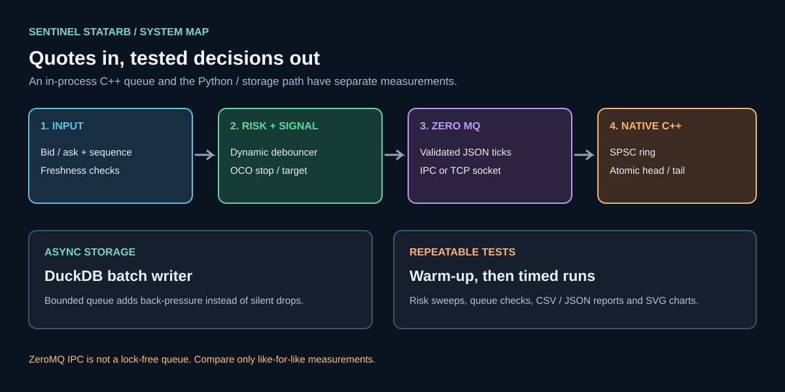

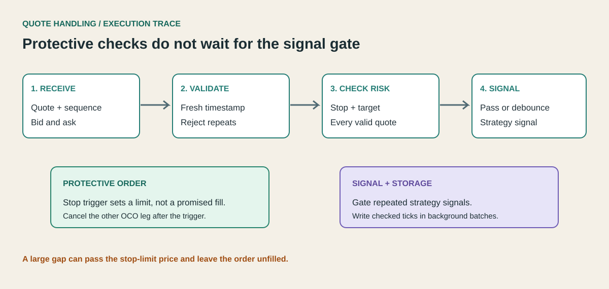

## Quick start

Requirements: Python 3.10+, a C++17 compiler, and CMake 3.16+. The native ZeroMQ benchmark is optional and needs the libzmq development package plus pkg-config (for Ubuntu: `sudo apt-get install libzmq3-dev pkg-config`).

```bash
python -m venv .venv
# Linux / macOS
source .venv/bin/activate
# Windows PowerShell: .venv\Scripts\Activate.ps1

python -m pip install --upgrade pip
python -m pip install -e ".[ipc,storage,dev]"
```

Build and test the C++ code:

```bash
cmake -S . -B build -DCMAKE_BUILD_TYPE=Release
cmake --build build --parallel
ctest --test-dir build --output-on-failure
```

Run Python tests and validate the saved reports:

```bash
python -m unittest discover -s tests -v
python scripts/validate_reports.py
```

Run the combined local checks:

```bash
bash scripts/run_checks.sh
```

The combined script runs smaller storage checks by default. Set `SENTINEL_STORAGE_TICKS=10100000` to verify more than 10 million rows locally.

## Repeatable experiments

The experiment script runs one warm-up for each policy, then measures repeated runs and reports the median timing. The timing excludes that policy's warm-up run.

```bash
# Python quote and risk experiment
python scripts/run_experiments.py --ticks 100000 --repeats 3
python scripts/run_experiments.py --ticks 1000000 --repeats 3

# Native C++ benchmark: warm-up run, then measured run
bash scripts/run_cpp_benchmark.sh 1000000 artifacts/cpp_benchmark.json
bash scripts/run_cpp_benchmark.sh 10000000 artifacts/cpp_benchmark_10m.json

# Python ZeroMQ process-to-process round trip
python scripts/benchmark_zmq_ipc.py --ticks 20000 --warmup 2000 --out artifacts/zmq_ipc_benchmark.json

# Native C++ ZeroMQ IPC benchmarks (after installing libzmq3-dev and pkg-config)
./build/cpp/sentinel_shm_spsc_ipc_benchmark --messages 200000 --warmup 20000 --out artifacts/shm_spsc_ipc_benchmark.json
./build/cpp/sentinel_zmq_ipc_oneway_benchmark --messages 20000 --warmup 2000 --out artifacts/cpp_zmq_ipc_oneway_benchmark.json
./build/cpp/sentinel_zmq_ipc_benchmark --messages 20000 --warmup 2000 --out artifacts/cpp_zmq_ipc_benchmark.json

# Separate warm-up and measured DuckDB writes, then verify every row and sequence
python scripts/benchmark_storage.py --ticks 10100000 --batch-size 10000 --out artifacts/stress_ticks.duckdb

# Compare batch sizes using 100K ticks per run
python scripts/run_storage_batch_sweep.py --ticks 100000 --out-dir artifacts

# Refresh the diagrams from the saved JSON reports
python scripts/make_artifacts.py
python scripts/validate_reports.py
```

The DuckDB command writes a separate warm-up database and measured database. It reads the measured database back and checks the row count, distinct sequence count, sequence range, and bid/ask values. It prints progress during both passes. Database files are local test outputs and are not meant to be committed.

GitHub Actions runs the unit tests, native C++ queue tests, 100K quote experiments, 1M and 10M C++ processing benchmarks, native shared-memory and ZeroMQ tests, and real DuckDB write/read-back tests in the regular job. A separate 120-minute job runs the 10M-row DuckDB warm-up and measured passes so the normal 30-minute test limit cannot cancel it. A run is successful only when the report and data checks finish. See [the workflow](.github/workflows/ci.yml).

## Analysis and experiment images

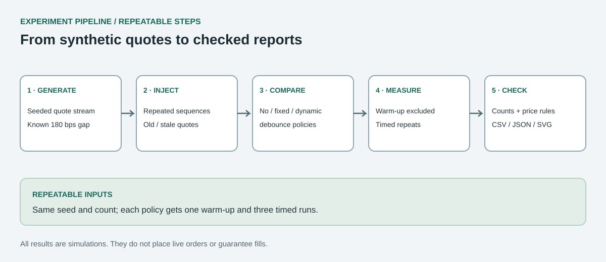

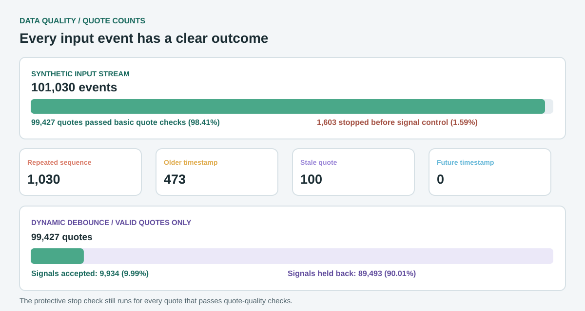

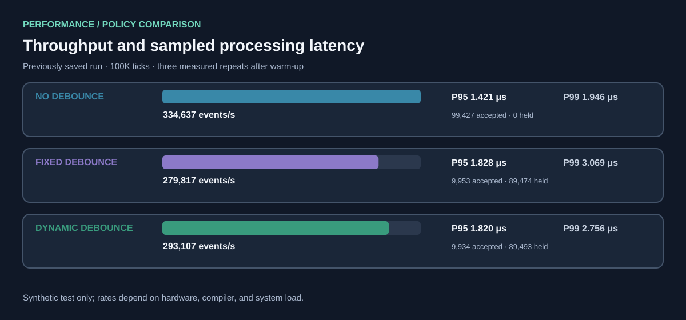

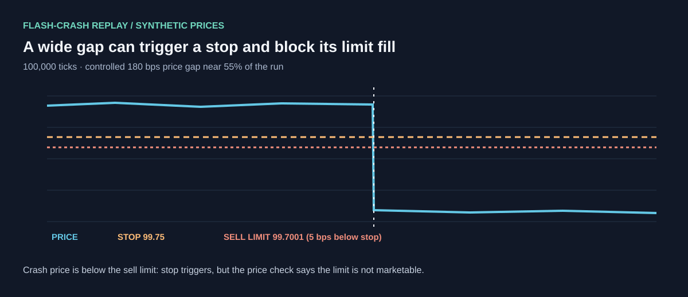

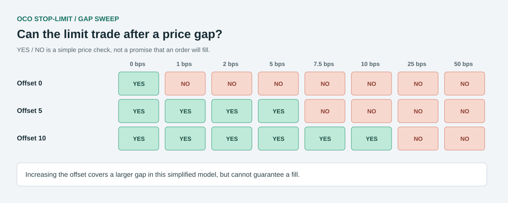

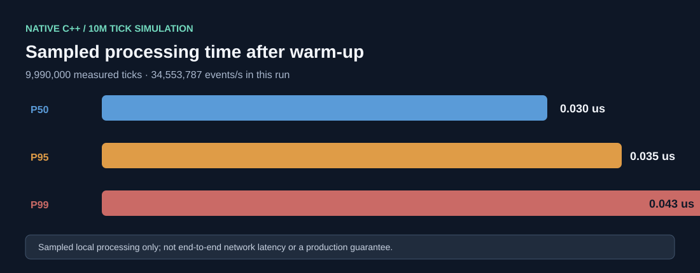

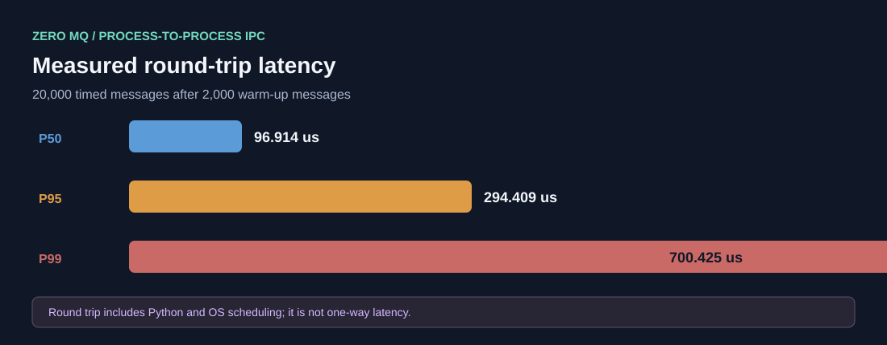

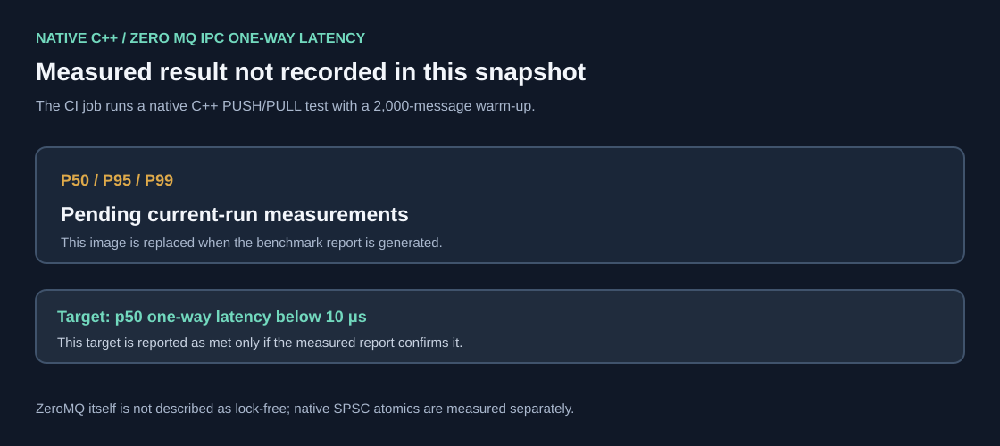

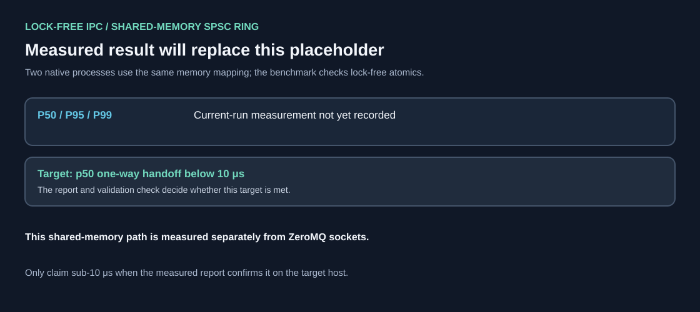

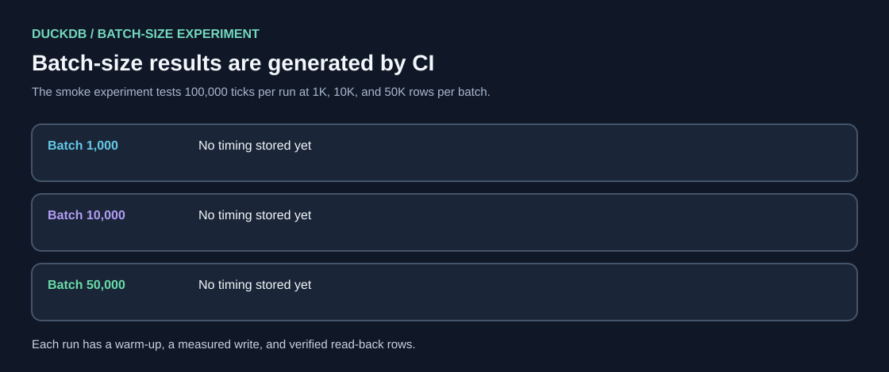

See the [experiment notes](docs/EXPERIMENTS.md) and [reports and diagrams index](docs/README.md) for the saved results and how to reproduce them.

## Reading the numbers correctly

The checked-in JSON/CSV files and diagrams are reference runs from synthetic data. Throughput and latency change with the CPU, operating system, compiler, process scheduling, and test settings. Re-run the commands above to produce results for your machine.

The saved 10M C++ report records about **34.55 million events/second** and **0.043 μs sampled p99 processing latency** for that run. That is sampled native event-processing time, not end-to-end market latency.

The saved native C++ ZeroMQ report records about **56.5 μs p50 one-way latency** and **114.3 μs p50 round-trip latency** in a paced, 20K-message run. That does not meet a sub-10 μs ZeroMQ claim, and ZeroMQ is not lock-free. The process-shared SPSC benchmark measures the separate lock-free shared-memory path. Its report is the evidence for any sub-10 μs lock-free handoff claim; the result varies by host and must not be inferred from the ZeroMQ timing.

A 5 bps stop-limit offset sets a price boundary; it does not promise a fill. The gap sweep deliberately includes price moves larger than the offset so this limitation is visible in the tests.

## Main files

- `sentinel_runtime/`: Python quote validation, debouncing, risk rules, ZeroMQ bridge, and DuckDB writer
- `cpp/`: C++17 event simulation, process-shared lock-free SPSC ring, ZeroMQ benchmarks, and native tests
- `tests/`: Python unit and integration tests
- `scripts/`: benchmarks, report generation, and report validation
- `artifacts/`: synthetic experiment results in CSV/JSON format
- `docs/assets/`: system, execution, data-quality, and benchmark SVGs

## Author and license

Author: **Pirate-Emperor**.

The project uses the MIT License. See [LICENSE](LICENSE).
