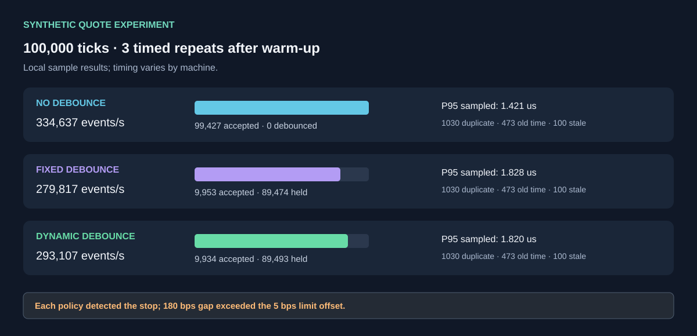

# Sentinel StatArb

**C++17 execution simulation · Python risk checks · ZeroMQ adapter · DuckDB batch logging**

Sentinel StatArb is a testable market-event pipeline for studying fast quote handling, repeated-signal control, and stop-limit behavior during sharp price moves. It includes a native C++ queue benchmark and a Python simulation with repeatable data checks. The examples use synthetic data; they do not place live orders.

## What is included

- **Native C++ engine simulation.** A single-producer/single-consumer (SPSC) ring uses atomics to move tick records between threads. The benchmark warms up before collecting throughput and sampled processing latency.
- **Quote checks and signal control.** Repeated sequence numbers, old timestamps, stale quotes, and future timestamps are rejected. A dynamic debouncer lengthens its quiet period after a sharp move. Protective orders are checked on every valid quote, even when strategy signals are held back.
- **OCO stop-limit model.** A stop and take-profit share one order state; after one fires, the other is cancelled. The default stop-limit price is offset by 5 basis points (bps) from the stop trigger.
- **ZeroMQ message adapter.** Validated JSON tick messages can be sent using a pyzmq async socket. The adapter can use IPC or TCP endpoints supplied by the caller.
- **DuckDB batch writer.** A bounded queue feeds one database-writing thread. Batches reduce per-tick overhead; a full queue applies back-pressure instead of silently dropping ticks.
- **Repeatable experiments.** Test streams include duplicate quotes, out-of-order timestamps, stale messages, and a controlled 180 bps price gap. Results are saved as CSV/JSON and SVG diagrams.

> **Important limits:** the SPSC ring is an in-process lock-free queue; ZeroMQ is a separate IPC/network transport and is not described as lock-free. A 5 bps stop-limit offset is a price bound, not a fill guarantee. When a crash gaps farther than the offset, the order can trigger but remain unfilled. Benchmark rates depend on the machine and are not live-market claims.

## Quick start

Use Python 3.10 or newer, a C++17 compiler, and CMake 3.16 or newer.

    python -m venv .venv
    # Linux / macOS:
    source .venv/bin/activate
    # Windows PowerShell:
    # .venv\Scripts\Activate.ps1
    python -m pip install --upgrade pip
    python -m pip install -e ".[ipc,storage,dev]"

Build and test the C++ engine:

    cmake -S . -B build -DCMAKE_BUILD_TYPE=Release
    cmake --build build --parallel
    ctest --test-dir build --output-on-failure

Run Python tests and repeatable experiments:

    python -m unittest discover -s tests -v
    python scripts/run_experiments.py --ticks 100000 --repeats 3
    python scripts/make_artifacts.py

The scripts run one unmeasured warm-up for each policy, then take the median of timed runs. Increase the data size for a heavier experiment:

    python scripts/run_experiments.py --ticks 1000000 --repeats 3
    python scripts/run_experiments.py --ticks 10000000 --repeats 3

Run the C++ benchmark twice at the selected size; only the second run is saved as the measurement:

    bash scripts/run_cpp_benchmark.sh 10000000 artifacts/cpp_benchmark_10m.json

Measure ZeroMQ IPC round trips (not one-way latency):

    python scripts/benchmark_zmq_ipc.py --ticks 20000 --warmup 2000 --out artifacts/zmq_ipc_benchmark.json

Run the DuckDB persistence stress test. The script does one full warm-up run, then writes a separate measured database and checks the row count and sequence range:

    python scripts/benchmark_storage.py --ticks 10000000 --batch-size 10000 --out artifacts/stress_ticks.duckdb

The storage test needs the storage extra. It creates a local database file; do not commit that file. Smaller counts are useful for quick checks.

## Diagrams and results

### System map

### Quote validation and risk checks

### Policy comparison

### Native C++ benchmark

### Flash-crash example

### Stop-limit gap sweep

### ZeroMQ IPC test

The checked-in reports include experiment_summary.json, experiment_metrics.csv, oco_gap_sweep.csv, cpp_benchmark_10m.json, and zmq_ipc_benchmark.json. The image script refreshes the SVGs from the experiment report. There is no main.png; the project uses the smaller SVG reports above.

## Configuration notes

DynamicDebouncer takes a base quiet period, a maximum quiet period, and a move size (in bps) that starts extending the wait. OCOStopLimit accepts entry price, side, stop distance, take-profit distance, and limit offset. Quote-age limits are set on ExecutionEngine. The ZeroMQ adapter accepts an existing async socket, so endpoint and bind/connect choices remain with the caller.

The IPC result is a process-to-process round trip and includes Python and operating-system scheduling. It does not measure one-way latency. AsyncDuckDBTickLogger has start, log, log_many, and close methods. Call close to flush the final partial batch. If DuckDB is missing or the writer fails, the logger raises an error instead of claiming records were stored.

## Tests

The suite covers quote validation, sequence/timestamp ordering, stale/future quote rejection, adaptive debounce behavior, the 5 bps offset, one-shot OCO behavior, large-gap non-fill behavior, deterministic experiment output, ZeroMQ message round-trip, and bounded async batching. A separate DuckDB test runs when the optional dependency is installed. The C++ test checks ring capacity and ordering across 500,000 values, debounce rules, and OCO stop-limit math.

Run the main checks:

    bash scripts/run_checks.sh

The GitHub Actions workflow installs the optional dependencies, runs the core tests and benchmarks, performs a 10-million-row DuckDB persistence test, and saves the reports as build artifacts.

## Files

- sentinel_runtime/ — Python quote checks, debouncing, risk, ZeroMQ, and DuckDB modules
- cpp/ — C++17 simulation, SPSC ring, and native tests
- scripts/ — experiments, asset generation, and benchmarks
- tests/ — Python unit and optional storage tests
- artifacts/ — experiment CSV/JSON reports (no database file)
- docs/assets/ — SVG architecture and analysis images

## License and author

Project author: **Pirate-Emperor**.

The license files are kept separate because they contain different license terms. Required copyright and license notices remain in those files and in the relevant source files.
