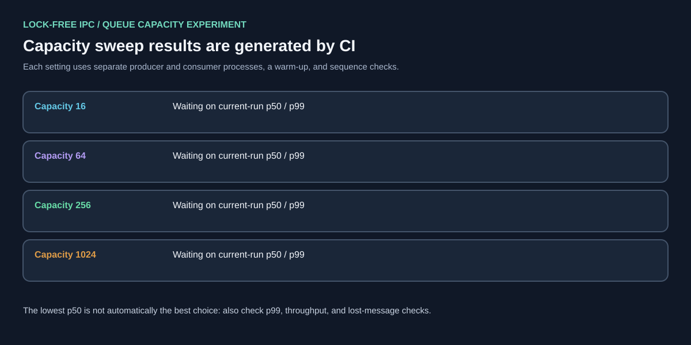

# Sentinel StatArb

**A small market-event test system using C++17, Python, ZeroMQ, and DuckDB.**

Sentinel StatArb tests how fast quote streams behave when they contain repeated messages, old timestamps, stale quotes, and a sudden price gap. It combines a native C++ queue simulation with Python checks for signal control, protective stop-limit orders, message transport, and batch storage.

All examples use synthetic data. The project does not connect to a broker or place live orders.

## At a glance

- **Native C++ engine:** SPSC ring buffer and an event-processing benchmark. The benchmark reports whether its atomics are lock-free on the current machine.
- **Paired GIL comparison:** Runs the same deterministic synthetic quote stream through native C++ and a CPython producer/consumer pipeline, enforces output parity, and measures the throughput ratio after warm-up. The host is recorded; an HPC claim requires a report produced on the HPC machine.
- **Quote checks:** Reject repeated sequence numbers, out-of-order timestamps, stale quotes, and timestamps too far in the future.
- **Dynamic debouncer:** Holds back repeated strategy signals for longer after a sharp price move. Protective order checks still run for every quote that passes the quality checks.
- **OCO stop-limit model:** Tests stop/target behavior and a 5 bps stop-limit offset. A triggered stop-limit order can remain unfilled after a large gap.
- **ZeroMQ bridge:** Sends validated tick messages over IPC or TCP. Native C++ tests measure one-way and round-trip latency separately. ZeroMQ itself is not lock-free, and the saved run did not meet the 10 μs one-way target.
- **Lock-free shared-memory IPC:** A native SPSC ring passes messages between two processes using shared memory. The benchmark checks whether the atomic counters are actually lock-free on the host, verifies sequence order, and measures one-way handoff time.
- **DuckDB writer:** Uses a bounded queue and a separate writer thread. Pandas DataFrame batches reduce per-row insert overhead; read-back checks verify every sequence and quote.
- **Repeatable experiments:** Save CSV/JSON measurements and SVG diagrams for the quote policies, crash scenario, and timing results.

## System view


## Quick start

Requirements: Python 3.10+, a C++17 compiler, and CMake 3.16+. The native ZeroMQ benchmark is optional and needs the libzmq development package plus pkg-config (for Ubuntu: `sudo apt-get install libzmq3-dev pkg-config`).

```bash
python -m venv .venv
# Linux / macOS
source .venv/bin/activate
# Windows PowerShell: .venv\Scripts\Activate.ps1

python -m pip install --upgrade pip
python -m pip install -e ".[ipc,storage,dev]"
```

Build and test the C++ code:

```bash
cmake -S . -B build -DCMAKE_BUILD_TYPE=Release
cmake --build build --parallel
ctest --test-dir build --output-on-failure
```

Run Python tests and validate the saved reports:

```bash
python -m unittest discover -s tests -v
python scripts/validate_reports.py
```

Run the combined local checks:

```bash
bash scripts/run_checks.sh
```

The combined script runs smaller storage checks by default. Set `SENTINEL_STORAGE_TICKS=10100000` to verify more than 10 million rows locally.

## Repeatable experiments

The experiment script runs one warm-up for each policy, then measures repeated runs and reports the median timing. The timing excludes that policy's warm-up run.

```bash
# Python quote and risk experiment
python scripts/run_experiments.py --ticks 100000 --repeats 3
python scripts/run_experiments.py --ticks 1000000 --repeats 3

# Native C++ benchmark: warm-up run, then measured run
bash scripts/run_cpp_benchmark.sh 1000000 artifacts/cpp_benchmark.json
bash scripts/run_cpp_benchmark.sh 10000000 artifacts/cpp_benchmark_10m.json

# Paired native C++ vs CPython-threaded execution pipeline
python scripts/benchmark_gil_pipeline.py --ticks 1000000 --repeats 3 --out artifacts/gil_comparison_benchmark.json

# Python ZeroMQ process-to-process round trip
python scripts/benchmark_zmq_ipc.py --ticks 20000 --warmup 2000 --out artifacts/zmq_ipc_benchmark.json

# Native C++ ZeroMQ IPC benchmarks (after installing libzmq3-dev and pkg-config)
./build/cpp/sentinel_shm_spsc_ipc_benchmark --messages 200000 --warmup 20000 --capacity 64 --out artifacts/shm_spsc_ipc_benchmark.json
python scripts/run_shm_spsc_capacity_sweep.py --messages 200000 --warmup 20000 --out-dir artifacts
./build/cpp/sentinel_zmq_ipc_oneway_benchmark --messages 20000 --warmup 2000 --out artifacts/cpp_zmq_ipc_oneway_benchmark.json
./build/cpp/sentinel_zmq_ipc_benchmark --messages 20000 --warmup 2000 --out artifacts/cpp_zmq_ipc_benchmark.json

# Separate warm-up and measured DuckDB writes, then verify every row and sequence
python scripts/benchmark_storage.py --ticks 10100000 --batch-size 10000 --out artifacts/stress_ticks.duckdb

# Compare batch sizes using 100K ticks per run
python scripts/run_storage_batch_sweep.py --ticks 100000 --out-dir artifacts

# Refresh the diagrams from the saved JSON reports
python scripts/make_artifacts.py
python scripts/validate_reports.py
```

The DuckDB command writes a separate warm-up database and measured database. It reads the measured database back and checks the row count, distinct sequence count, sequence range, and bid/ask values. It prints progress during both passes. Database files are local test outputs and are not meant to be committed.

GitHub Actions runs the unit tests, native C++ queue tests, 100K quote experiments, 1M and 10M C++ processing benchmarks, native shared-memory and ZeroMQ tests, and real DuckDB write/read-back tests in the regular job. A separate 120-minute job runs the 10M-row DuckDB warm-up and measured passes so the normal 30-minute test limit cannot cancel it. A run is successful only when the report and data checks finish. See [the workflow](.github/workflows/ci.yml).

## Analysis and experiment images





See the [experiment notes](docs/EXPERIMENTS.md) and [reports and diagrams index](docs/README.md) for the saved results and how to reproduce them.

## Reading the numbers correctly

The checked-in JSON/CSV files and diagrams are reference runs from synthetic data. Throughput and latency change with the CPU, operating system, compiler, process scheduling, and test settings. Re-run the commands above to produce results for your machine.

### Verification status — HPC run completed successfully

**[integrator-1 HPC CPU Validation #8 passed](https://github.com/SpryzenHell/integrator/actions/runs/38569070387)** on `scn11-mn.mgmt.siddhi.param` (dual AMD EPYC 7742 CPUs; 2× A100 GPUs present but not used by this CPU benchmark; Ubuntu 22.04, GCC 11.4, CPython 3.12.15). The tested Sentinel StatArb source was `4958b6dde6f8bda5dbbfc4b52b72adb2b64c7d43`. Python tests passed 24/24, native CTest passed 4/4, and all generated-report validation checks passed.

| Claim area | Measured HPC evidence | Important boundary |
|---|---|---|
| Native C++ execution engine | 10M synthetic ticks: **37.77M events/s**, 0.050 μs sampled p50 and **0.051 μs sampled p99** processing latency; zero invalid ticks. | Sampled timing wraps order/debouncer processing, not end-to-end market-to-order latency. |
| Python GIL comparison | On the paired 1M-tick workload: native C++ **48.79M events/s** vs GIL-enabled CPython producer/consumer **264.6K events/s**; **184.39×** measured pipeline throughput ratio. Signal counts, stop outcome and invalid-tick checks matched. | This compares the full native SPSC pipeline with Python `queue.Queue`, including object/queue overhead—not isolated GIL overhead alone. Host/workload-specific. |
| Dynamic debouncer + 5 bps OCO | Accepted signals fell from **99,427** without debounce to **9,934** with dynamic debounce (**90.01% fewer**). The 180 bps crash gap triggered the stop, but the 5 bps-offset stop-limit was not marketable afterward. | Synthetic backtest only; this does not establish live P&L, actual slippage reduction, or guaranteed fills. |
| Quote integrity + lock-free IPC | Duplicate/out-of-order/stale quote rejection verified; shared-memory SPSC capacity 16 delivered **3.397 μs p50 / 6.102 μs p99** with lock-free atomics and zero sequence/timestamp errors. | The low-latency path is **shared-memory SPSC, not ZeroMQ**. ZeroMQ one-way p50/p99 were 25.999/31.009 μs and its transport is not lock-free. The shared-memory maximum also had scheduler outliers, so quote percentiles rather than an absolute bound. |
| Async DuckDB logging | **10.1M rows** written and read back; 10.1M distinct sequences spanning 0–10,099,999; zero invalid quotes; **241.7K rows/s** in the measured pass (41.79 s). | Synthetic data and host-specific disk/CPU throughput. |

Full host details, raw metrics, IPC capacity sweep, OCO gap test, and caveats are recorded in [the HPC validation report](docs/HPC_VALIDATION_2026-10-14.md). Machine-readable results are persisted under [`integrator/main/artifacts/sentinel-statarb-hpc/`](https://github.com/SpryzenHell/integrator/tree/main/artifacts/sentinel-statarb-hpc).

### Resume wording supported by current evidence

- **Native engine:** Built a native C++17 execution simulator; on an AMD EPYC HPC node it processed 10M synthetic ticks at 37.77M events/s (0.051 μs sampled p99 hot-path processing). A paired GIL-enabled CPython pipeline benchmark showed 184.39× higher measured throughput with execution/risk parity.
- **Crash controls:** Implemented dynamic signal debouncing and 5 bps OCO stop-limit protection; in a seeded 180 bps crash-gap replay, dynamic debounce accepted 90.01% fewer signals than no debounce, and the test confirmed that a gap-through stop-limit can remain unfilled.
- **Quote integrity / persistence:** Rejected duplicate, out-of-order and stale quotes; benchmarked lock-free process-shared SPSC IPC at 3.397 μs p50 / 6.102 μs p99 and asynchronously wrote/read-validated 10.1M DuckDB rows with zero invalid quotes.

Do not label the low-latency shared-memory IPC result as “lock-free ZeroMQ,” and do not claim live-market profitability based on these synthetic tests.

## Main files

- `sentinel_runtime/`: Python quote validation, debouncing, risk rules, ZeroMQ bridge, and DuckDB writer
- `cpp/`: C++17 event simulation, process-shared lock-free SPSC ring, ZeroMQ benchmarks, and native tests
- `artifacts/`: reports from the shared-memory queue capacity sweep and the storage checks
- `tests/`: Python unit and integration tests
- `scripts/`: benchmarks, report generation, and report validation
- `artifacts/`: synthetic experiment results in CSV/JSON format
- `docs/assets/`: system, execution, data-quality, and benchmark SVGs

## Author and license

Author: **Pirate-Emperor**.

The project uses the MIT License. See [LICENSE](LICENSE).


---

# Complete experiment ledger (reproducibility record)

This section intentionally records experiment inputs, measurement boundaries, raw result summaries, and limitations in one place. Older reference figures above are not overwritten silently: each subsection identifies whether its figures came from the HPC host or a hosted GitHub runner.

## A. Run provenance and evidence hierarchy

| Evidence source | Run / revision | Result | Proper use |
|---|---|---|---|
| HPC workflow | [Run #8](https://github.com/SpryzenHell/integrator/actions/runs/38569070387); source revision 4958b6dde6f8bda5dbbfc4b52b72adb2b64c7d43 | Success | Primary evidence for the named HPC host’s C++ throughput, GIL comparison, IPC, synthetic quote/risk checks and 10.1M-row DuckDB write/read-back. |
| Hosted CI reference run #38571748960 (crash-window schema) | [Run #38571748960](https://github.com/SpryzenHell/sentinel_statarb/actions/runs/38571748960) | Success | Evidence for the new first-200-slot crash-window counters and report generation, plus the shown hosted benchmark values. |
| HPC adaptive crash-window follow-up | [Run #9](https://github.com/SpryzenHell/integrator/actions/runs/38571496094) | Queued at last status check (2026-10-14 14:14 UTC) | Another A100 workflow, GraphRAG run #38570981068, was still in progress on the shared runner. HPC #8 remains the latest successful HPC result; do not attribute the post-crash window metric to HPC until #9 completes successfully. |
| Hosted CI raw report artifact | [Run #38571748960 artifacts](https://github.com/SpryzenHell/sentinel_statarb/actions/runs/38571748960) | Published | Contains JSON/CSV output and diagrams for the run. |
| Persisted HPC report tree | [integrator/main/artifacts/sentinel-statarb-hpc](https://github.com/SpryzenHell/integrator/tree/main/artifacts/sentinel-statarb-hpc) | Contains run #8 report files | Host metadata and JSON/CSV measures; the run-status file names the tested source revision. |

The correct evidence hierarchy is: generated JSON plus machine/source provenance first; workflow outcome and logs second; diagrams as a visualization of the JSON, not an independent measurement. A canceled job, partial stress test, or report from a different commit is not a verified result for the current source.

## B. Native event simulation — measurement definitions

The native benchmark uses a C++17 Release build and reports total ticks, warm-up count, measured tick count, throughput, sampled processing latency quantiles, invalid-tick count, and whether its SPSC atomics report lock-free on that host. The shell benchmark helper performs a warm-up invocation before the measured invocation. The later report records a warm-up of 10,000 ticks and excludes those ticks from its measured throughput count.

| Host/run | Input | Measured ticks | Events/s | Sampled p50 | Sampled p95 | Sampled p99 | Invalid ticks | Atomic status |
|---|---:|---:|---:|---:|---:|---:|---:|---|
| HPC #8 | 1,000,000 | 990,000 | 41,833,531 | 0.050 μs | 0.051 μs | 0.060 μs | 0 | Lock-free |
| HPC #8 | 10,000,000 | 9,990,000 | 37,767,022 | 0.050 μs | 0.051 μs | 0.051 μs | 0 | Lock-free |
| Hosted CI #38571748960 | 1,000,000 | 990,000 | 46,080,811 | 0.040 μs | 0.070 μs | 0.071 μs | 0 | Lock-free |
| Hosted CI #38571748960 | 10,000,000 | 9,990,000 | 47,227,394 | 0.050 μs | 0.070 μs | 0.070 μs | 0 | Lock-free |
| Older checked-in reference | 10,000,000 | 9,990,000 | 34,553,787 | 0.030 μs | 0.035 μs | 0.043 μs | 0 | Lock-free |

**Timing boundary:** sampled processing latency times only the native order/debouncer hot path. It is not quote-receive-to-order transmission latency, full simulation wall time, broker latency, or network round trip. The throughput figures include the benchmark’s event pipeline workload and cannot be derived from or equated to one sampled latency quantile.

## C. Paired C++ and CPython threaded pipeline — full method

The paired benchmark exists to measure a complete implementation comparison rather than infer GIL effects from unrelated tests.

1. Construct one deterministic unsigned-64-bit LCG quote/price sequence and identical timestamps for both implementations.
2. Use a bounded producer/consumer path with 65,536 slots: native C++ SPSC versus CPython threading with queue.Queue.
3. Apply matching debounce configuration, stress threshold, stop trigger and stop-limit offset; inject the same large price gap.
4. Run a full warm-up invocation for each implementation.
5. Run repeated measured invocations, alternate implementations to reduce fixed order bias, and summarize throughput/timing with the median.
6. Check exact agreement for total ticks, warm-up and measured counts, accepted/debounced counters, stop count, stop-limit marketability at the gap, invalid-tick count and capacity.
7. Record Python implementation/version, GIL-enabled status, CPU count, binary path, raw repeat values and aggregate throughput ratio in JSON.

| Metric | HPC #8 | Hosted CI #38571748960 |
|---|---:|---:|
| Requested ticks per implementation | 1,000,000 | 1,000,000 |
| Warm-up ticks | 10,000 | 10,000 |
| Measured ticks | 990,000 | 990,000 |
| Native C++ median throughput | 48,794,396 events/s | 45,907,110 events/s |
| Python threaded median throughput | 264,621 events/s | 147,902 events/s |
| Native/Python throughput ratio | **184.39×** | **310.39×** |
| Native sampled processing p50/p95/p99 | 0.040 / 0.051 / 0.051 μs | 0.040 / 0.070 / 0.071 μs |
| Python sampled processing p50/p95/p99 | 1.333 / 1.483 / 1.593 μs | 1.121 / 2.043 / 2.634 μs |
| Accepted / held signals | 99,980 / 900,020 | 99,980 / 900,020 |
| Stop triggers | 1 | 1 |
| Limit marketable after gap | No | No |
| Invalid ticks | 0 | 0 |
| Semantic parity | Pass | Pass |

The ratio is workload-specific and includes the full queue and language path. It combines effects from queue implementation, Python objects/interpreter execution, threading/GIL behavior, compiler optimization, and host scheduling. Do not describe it as a controlled estimate of the GIL’s isolated contribution or as a universal speedup factor.

## D. Quote-quality fault injection

The default seeded experiment starts from 100,000 base ticks and inserts repeats, producing 101,030 total input events. The deterministic fault counts and accounting identities are:

| Counter | Count | Meaning |
|---|---:|---|
| Duplicate sequences | 1,030 | Repeated sequence IDs are rejected before they can produce a new strategy signal. |
| Out-of-order timestamps | 473 | A valid event cannot move the engine’s accepted event-time state backward. |
| Stale quotes | 100 | Quote age exceeds the allowed maximum. |
| Future quotes | 0 | This seed does not inject a future timestamp; separate tests cover future-dated rejection. |
| Total quality rejects | 1,603 | 1,030 + 473 + 100. |
| Remaining valid events | 99,427 | 101,030 − 1,603; equals no-debounce accepted signals. |

The quote-health test is designed to prove accounting, not only that a handler returns an error: event categories must sum to the known input total. It also proves the protective order path can still trigger when the strategy signal gate declines a new entry.

## E. Debounce policy comparison and post-crash window

### Whole-stream results

One warm-up run is discarded for each policy; three timed repeats are summarized by the median in hosted CI run #38571748960.

| Policy | Accepted | Held back | Accepted-signal reduction | Events/s | Sampled p50 | p95 | p99 |
|---|---:|---:|---:|---:|---:|---:|---:|
| No debounce | 99,427 | 0 | 0.00% | 360,336 | 1.242 μs | 1.342 μs | 1.492 μs |
| Fixed debounce | 9,953 | 89,474 | 89.99% | 282,367 | 1.993 μs | 2.113 μs | 2.323 μs |
| Dynamic debounce | 9,934 | 89,493 | 90.01% | 284,069 | 1.973 μs | 2.093 μs | 2.264 μs |

The two debounce schemes both reduce full-stream accepted signals substantially. Because the fixed gate already suppresses ordinary repeats, the difference in whole-stream acceptance (9,953 versus 9,934) by itself would not be enough to describe a special crash response. That is why the experiment now emits a separate local window counter.

### First 200 sequence slots at the crash

The price drops by 180 bps at sequence 55,000 (55% of the 100,000 base stream). The first 200 sequence slots include 199 quotes that pass quality checks.

| Policy | Valid quote count | Accepted entry signals | Held back | Accepted fraction |
|---|---:|---:|---:|---:|
| No debounce | 199 | 199 | 0 | 100.00% |
| Fixed debounce | 199 | 20 | 179 | 10.05% |
| Dynamic debounce | 199 | 0 | 199 | 0.00% |

This demonstrates the expected local policy behavior under that deterministic timing/price input. It does not prove financial damage was avoided. The model tracks entry-signal allowance and protective order state; it does not calculate a live portfolio’s net exposure or fills.

A further regression check requires the post-crash counts to reconcile (valid equals accepted plus held back), all policies to inspect the same window size, and accepted-entry count to decrease from no-debounce to fixed to dynamic. The SVG snapshot is generated from these report fields.

## F. OCO stop-limit tests and 24-case gap matrix

Standard execution setup: long position reference price 100, 25 bps stop, and 5 bps offset. The grid checks offsets 0/5/10 bps against 0/1/2/5/7.5/10/25/50 bps post-trigger price gaps.

| Offset | 0 bps gap | 1 bps | 2 bps | 5 bps | 7.5 bps | 10 bps | 25 bps | 50 bps |
|---:|---:|---:|---:|---:|---:|---:|---:|---:|
| 0 bps | Marketable | Not marketable | Not marketable | Not marketable | Not marketable | Not marketable | Not marketable | Not marketable |
| 5 bps | Marketable | Marketable | Marketable | Marketable | Not marketable | Not marketable | Not marketable | Not marketable |
| 10 bps | Marketable | Marketable | Marketable | Marketable | Marketable | Marketable | Not marketable | Not marketable |

Tests assert the price-boundary arithmetic, order direction, invalid offset rejection, one-shot OCO firing, risk checks even when debounce holds an entry, and unmarketable state after the 180 bps gap. “Marketable” is a simple price condition, not execution confirmation.

## G. Lock-free shared-memory SPSC — all measured capacities

The shared-memory SPSC experiment uses distinct producer and consumer processes sharing memory. It samples producer timestamp through consumer pop on the same host monotonic clock, performs a payload/sequence check, checks the relevant atomics for lock-free support and reports all latency percentiles. Each capacity uses a fresh pair, 20,000 warm-ups, and 200,000 measured messages.

### HPC run #8

| Capacity | p50 | p95 | p99 | Max observed | Throughput | Sequence/time errors |
|---:|---:|---:|---:|---:|---:|---|
| 16 | 3.397 μs | 3.887 μs | 6.102 μs | 1,428.499 μs | 2,481,100 msg/s | 0 |
| 64 | 7.434 μs | 10.500 μs | 12.172 μs | 644.894 μs | 4,752,715 msg/s | 0 |
| 256 | 24.386 μs | 28.254 μs | 30.127 μs | 819.865 μs | 6,456,455 msg/s | 0 |
| 1,024 | 90.661 μs | 107.935 μs | 112.243 μs | 173.168 μs | 7,106,096 msg/s | 0 |

### Hosted-CI sweep

| Capacity | p50 | p95 | p99 | Max observed | Throughput | Sequence/time errors |
|---:|---:|---:|---:|---:|---:|---|
| 16 | 0.987 μs | 1.247 μs | 2.329 μs | 88.709 μs | 10,420,587 msg/s | 0 |
| 64 | 5.022 μs | 6.475 μs | 16.831 μs | 121.639 μs | 10,504,364 msg/s | 0 |
| 256 | 22.168 μs | 25.904 μs | 57.612 μs | 84.523 μs | 10,703,923 msg/s | 0 |
| 1,024 | 88.328 μs | 172.064 μs | 220.317 μs | 286.317 μs | 9,545,609 msg/s | 0 |

Every setting reported lock-free atomics and zero sequence/timestamp errors. Capacity 16 gave the lowest p50 and p99 in both runs. The high maximum observed at HPC capacity 16 and differences between hosts show that percentiles are not a hard latency bound. The ring capacity changes queueing and cache/scheduling behavior; it is not safe to tune from p50 alone.

### Standalone capacity-64 measurements

| Host | p50 | p95 | p99 | Throughput | Measured messages |
|---|---:|---:|---:|---:|---:|
| HPC run #8 | 7.584 μs | 10.620 μs | 12.263 μs | 4,762,943 msg/s | 200,000 |
| Hosted CI | 5.102 μs | 6.315 μs | 7.787 μs | See raw JSON | 200,000 |

The capacity-64 standalone result and capacity-64 sweep may differ because the sender/receiver process pair, scheduler and backlog differ between test invocations. Use each report’s own metrics.

## H. ZeroMQ — complete separate transport results

ZeroMQ uses IPC sockets and is **not lock-free**. The paced native one-way benchmark puts a timestamp in a message and waits for acknowledgment so it does not accumulate an unbounded sender backlog. The request/reply round-trip benchmark measures a different interval.

| Host / implementation | Measurement | p50 | p95 | p99 | Notes |
|---|---|---:|---:|---:|---|
| HPC C++ | One-way | 25.999 μs | 27.863 μs | 31.009 μs | 20K measured; payload verified; not lock-free |
| HPC C++ | ACK RTT | 51.448 μs | — | 60.535 μs | Mean 53.183 μs |
| HPC C++ | Request/reply RTT | 51.398 μs | 56.848 μs | 61.456 μs | ~18,852 RTT/s |
| HPC Python | Request/reply RTT | 61.957 μs | 67.007 μs | 72.938 μs | Includes Python/scheduler overhead |
| Hosted C++ | One-way | 36.940 μs | 47.121 μs | 65.884 μs | Payload verified |
| Hosted C++ | Request/reply RTT | 73.932 μs | 92.359 μs | 108.054 μs | Not lock-free |
| Hosted Python | Request/reply RTT | 81.684 μs | 101.323 μs | 147.463 μs | Process-to-process |

Historical native reference: one-way p50/p95/p99 56.513/63.731/67.720 μs and ACK RTT p50 111.148 μs. These historical values also miss the target. They are retained for provenance and are not substituted for the current runs.

## I. DuckDB batch and full persistence experiments

### Batch sweep (hosted CI run #38571748960)

Each batch size gets a warm-up run/database and separate measured write/read-back database, 100,000 requested rows per setting.

| Batch size | Elapsed | Rows/s | Rows read back | Unique IDs | Invalid quotes |
|---:|---:|---:|---:|---:|---:|
| 1,000 | 566.520 ms | 176,516 | 100,000 | 100,000 | 0 |
| 10,000 | 299.870 ms | 333,478 | 100,000 | 100,000 | 0 |
| 50,000 | 280.546 ms | 356,448 | 100,000 | 100,000 | 0 |

50K batching showed about 2.02× the throughput of 1K batching in this sweep, but there was one measured run per setting. It is a tuning signal, not a confidence interval.

### Full stress run

| Metric | HPC #8 | Hosted full job #38571748960 |
|---|---:|---:|
| Warm-up rows | 10,100,000 | 10,100,000 |
| Measured rows requested | 10,100,000 | 10,100,000 |
| Rows written by logger | 10,100,000 | 10,100,000 |
| Rows read back | 10,100,000 | 10,100,000 |
| Distinct sequence IDs | 10,100,000 | 10,100,000 |
| Sequence range | 0–10,099,999 | 0–10,099,999 |
| Invalid bid/ask rows | 0 | 0 |
| Measured elapsed | 41,789.149 ms | 34,939.460 ms |
| Throughput | 241,689.538 rows/s | 289,071.441 rows/s |
| Database size | 136,065,024 bytes | 136,065,024 bytes |

The 100K smoke run in hosted CI #38571748960 additionally read back 100,000/100,000 rows, all IDs unique from 0–99,999, zero invalid quotes and 317,611 rows/s. The full test verifies both the logger’s output counter and the persisted database, including full uniqueness/range/quote checks.

## J. Reproduction commands by experiment

### Environment setup

```bash
python -m venv .venv
source .venv/bin/activate
python -m pip install --upgrade pip
python -m pip install -e ".[ipc,storage,dev]"
sudo apt-get install -y libzmq3-dev pkg-config
```

### Unit tests, static checks and native tests

```bash
python -m compileall -q sentinel_runtime scripts tests
python -m unittest discover -s tests -v
cmake -S . -B build -DCMAKE_BUILD_TYPE=Release
cmake --build build --parallel
ctest --test-dir build --output-on-failure
python scripts/validate_reports.py
```

### Quote policy, crash window and OCO matrix

```bash
python scripts/run_experiments.py --ticks 100000 --repeats 3 --out artifacts
python scripts/make_artifacts.py
python scripts/validate_reports.py
```

### Native C++ and paired GIL benchmark

```bash
bash scripts/run_cpp_benchmark.sh 1000000 artifacts/cpp_benchmark.json
bash scripts/run_cpp_benchmark.sh 10000000 artifacts/cpp_benchmark_10m.json
python scripts/benchmark_gil_pipeline.py --ticks 1000000 --repeats 3 --out artifacts/gil_comparison_benchmark.json
python scripts/validate_reports.py
```

### Shared-memory and ZeroMQ IPC

```bash
./build/cpp/sentinel_shm_spsc_ipc_benchmark --messages 200000 --warmup 20000 --capacity 64 --out artifacts/shm_spsc_ipc_benchmark.json
python scripts/run_shm_spsc_capacity_sweep.py --messages 200000 --warmup 20000 --out-dir artifacts

./build/cpp/sentinel_zmq_ipc_oneway_benchmark --messages 20000 --warmup 2000 --out artifacts/cpp_zmq_ipc_oneway_benchmark.json
./build/cpp/sentinel_zmq_ipc_benchmark --messages 20000 --warmup 2000 --out artifacts/cpp_zmq_ipc_benchmark.json
python scripts/benchmark_zmq_ipc.py --ticks 20000 --warmup 2000 --out artifacts/zmq_ipc_benchmark.json
python scripts/make_artifacts.py
python scripts/validate_reports.py
```

### Storage sweeps and stress test

```bash
python scripts/run_storage_batch_sweep.py --ticks 100000 --out-dir artifacts
python scripts/benchmark_storage.py --ticks 10100000 --batch-size 10000 --out artifacts/stress_ticks.duckdb
python scripts/make_artifacts.py
python scripts/validate_reports.py
```

Database binaries are local outputs; commit the source, scripts and small JSON/CSV/SVG summaries—not the 136 MB-class DuckDB test database.

## K. Artifacts and diagrams index

The main diagrams are all visible earlier in the README; the direct paths are:

- Architecture — docs/assets/architecture.svg
- Quote validation and risk flow — docs/assets/execution-flow.svg
- Synthetic experiment pipeline — docs/assets/experiment-pipeline.svg
- Quote data-quality counters — docs/assets/data-quality.svg
- Full-stream policy performance — docs/assets/performance-comparison.svg
- Experiment dashboard — docs/assets/experiment-dashboard.svg
- 180 bps crash price chart — docs/assets/flash-crash-analysis.svg
- Post-crash entry-signal suppression window — docs/assets/post-crash-signal-suppression.svg
- OCO gap-price marketability grid — docs/assets/oco-gap-sweep.svg
- C++ processing benchmark — docs/assets/cpp-benchmark.svg
- Python ZeroMQ round trip — docs/assets/zmq-ipc-latency.svg
- Native ZeroMQ one-way — docs/assets/zmq-ipc-oneway-latency.svg
- Shared-memory SPSC latency — docs/assets/shm-spsc-ipc-latency.svg
- SPSC capacity sweep — docs/assets/shm-spsc-capacity-sweep.svg
- DuckDB batch sweep — docs/assets/storage-batch-sweep.svg
- DuckDB storage performance — docs/assets/storage-benchmark.svg

Reports and files:
- Full hosted-CI artifacts: [Run #38571748960](https://github.com/SpryzenHell/sentinel_statarb/actions/runs/38571748960)
- Full HPC report JSON/CSV and provenance: [integrator/main artifact tree](https://github.com/SpryzenHell/integrator/tree/main/artifacts/sentinel-statarb-hpc)
- Detailed HPC metrics: docs/HPC_VALIDATION_2026-10-14.md
- Experiment methodology/reference notes: docs/EXPERIMENTS.md
- Figure index: docs/README.md

## L. Resume claims: verified wording and hard boundaries

**Native C++ / Python comparison (HPC #8):**

> Built a native C++17 market-event simulator on an AMD EPYC HPC host, processing 10M synthetic ticks at 37.77M events/s with 0.051 μs sampled p99 hot-path processing; a paired GIL-enabled CPython pipeline measured 184.39× lower throughput with matching signal/risk outcomes.

**Dynamic debounce / OCO (whole-stream metrics from hosted CI; post-crash window is also hosted-CI-verified):**

> Implemented dynamic signal debouncing and 5 bps OCO stop-limit protection; in a seeded 180 bps crash-gap replay, dynamic debounce accepted 90.01% fewer whole-stream signals than no debounce and admitted 0 of 199 valid entry opportunities in the first 200 post-crash slots, while testing the stop-limit gap-through/no-fill case.

Only call the first-200 window an HPC measurement after HPC run #9 completes successfully with that report field.

**Quote integrity / IPC / storage (HPC #8):**

> Rejected duplicate, out-of-order, stale and future-dated quotes; benchmarked lock-free process-shared SPSC IPC at 3.397 μs p50 / 6.102 μs p99 on the tested HPC configuration and asynchronously persisted 10.1M DuckDB rows with complete sequence/read-back validation and zero invalid quotes.

Key rules:
- Name the mechanism **shared-memory SPSC**, not “lock-free ZeroMQ.”
- A 3.397 μs p50 / 6.102 μs p99 result does not promise every message is within 10 μs; retain the host/percentile qualification.
- The 184.39× ratio compares whole native and Python pipelines; it is not a pure measurement of GIL overhead.
- The 90.01% accepted-signal reduction and post-crash zero-entry result are simulated behavior, not realized P&L or proof of reduced live-market loss.
- A 5 bps stop-limit offset constrains price; it does not guarantee an order fill.
- The A100 is present on the HPC host, but the project tests are CPU/IPC/storage benchmarks, not CUDA acceleration tests.

## M. Known workflow incidents and chronology

| Run / iteration | Outcome | Lesson / resolution |
|---|---|---|
| Initial HPC workflow attempts #1–#6 | Cancelled during workflow development | Workflow/configuration was changing; do not treat them as measurements. |
| HPC #7 | Failed before native benchmarks | Cleanup removed experiment_summary.json before a fixture-dependent Python test; cleanup was moved after unit tests. |
| HPC #8 | **Success** | Full test matrix and all first-pass HPC measurements and report validation passed. |
| Hosted crash-window development iteration | One failure, then later success | Unit tests caught a missing base-tick argument on measured repeat runs; it was fixed before later report generation passed. |
| HPC #9 | [Dedicated follow-up run](https://github.com/SpryzenHell/integrator/actions/runs/38571496094) | Repeats the latest crash-window schema on integrator-1; verify final status/results before upgrading the HPC claim. |

The benchmark outputs are tied to source revision and machine provenance. Canceled/failed runs and incomplete storage read-back are not successful evidence. This ledger is intentionally explicit about both passing work and limitations so that resume claims can be defended in review.


## N. Hosted-CI run #38577287975 — supplemental measurements

**Status:** success · **Commit tested:** 84fa009368c73d2dc0f1a6ab428668b038ca65e0 · **[Workflow page and artifacts](https://github.com/SpryzenHell/sentinel_statarb/actions/runs/38577287975)**.

This run validates the expanded README-linked SVG/report changes on the repository’s main branch. Both workflow jobs passed: the regular job and the separate 10.1M-row DuckDB stress job. Python tests passed **25/25**, native CTest passed **4/4**, and all generated report/CSV/SVG checks passed. These measurements are a newer hosted-run snapshot and are recorded separately from hosted run #385717 and HPC run #8 because timings vary materially between runners.

### Native C++ and paired Python results

| Measurement | Latest hosted CI #385772 |
|---|---:|
| Native C++ 1M ticks throughput | 31,622,567 events/s |
| Native C++ 1M sampled p50/p95/p99 | 0.050 / 0.051 / 0.060 μs |
| Native C++ 10M ticks throughput | 30,916,365 events/s |
| Native C++ 10M sampled p50/p95/p99 | 0.050 / 0.060 / 0.071 μs |
| Native invalid ticks | 0 |
| Paired native C++ median throughput | 32,148,828 events/s |
| Paired GIL-enabled CPython threaded median throughput | 127,491 events/s |
| Paired pipeline throughput ratio | **252.17×** |
| Paired native sampled p50/p95/p99 | 0.050 / 0.051 / 0.060 μs |
| Paired Python sampled p50/p95/p99 | 1.463 / 3.186 / 5.049 μs |
| Accepted / held signals in paired workload | 99,980 / 900,020 in both implementations |
| Stop triggers and marketability | 1 trigger each; stop-limit not marketable at injected gap |
| Parity checks | Pass; no invalid ticks |

The native throughput and ratio are lower/different than in other runs. This is not a contradiction: the runner is a four-logical-CPU GitHub hosted VM for this paired run, whereas HPC #8 used an AMD EPYC server. The host/workload result must travel with the number.

The exact raw throughput repeats in this run were 32,399,548, 31,741,759 and 32,148,828 events/s for C++; 127,855, 118,807 and 127,491 events/s for the CPython threaded pipeline. The report used three measured repeats after a warm-up invocation for each implementation.

### Signal policy and crash window

| Policy | Accepted full-stream signals | Held back | Throughput | Sampled p50/p95/p99 |
|---|---:|---:|---:|---:|
| No debounce | 99,427 | 0 | 275,190 events/s | 1.653 / 1.783 / 1.893 μs |
| Fixed debounce | 9,953 | 89,474 | 214,080 events/s | 2.645 / 2.806 / 3.105 μs |
| Dynamic debounce | 9,934 | 89,493 | 214,130 events/s | 2.655 / 2.815 / 3.086 μs |

The post-crash observation window is unchanged and reconciles correctly: 199 valid quotes; no debounce accepted 199; fixed debounce accepted 20 and held 179; dynamic debounce accepted zero and held all 199. All three policies triggered the protective stop once and the stop-limit was not marketable at the 180 bps gap. The 24-case 0/5/10 bps offset matrix also passed report validation.

### Shared-memory SPSC latest hosted measurements

Standalone capacity 64:

| Metric | Result |
|---|---:|
| p50 | 3.876 μs |
| p95 | 5.899 μs |
| p99 | 6.411 μs |
| Mean / maximum | 4.140 / 31.297 μs |
| Throughput | 14,019,304 messages/s |
| Measured messages | 200,000 |
| Atomics lock-free | Yes |
| Bad sequences / invalid timestamps | 0 / 0 |

Capacity sweep (20,000 warm-ups plus 200,000 measured messages at every capacity):

| Capacity | p50 | p95 | p99 | Maximum | Throughput |
|---:|---:|---:|---:|---:|---:|
| 16 | 1.110 μs | 1.461 μs | 2.763 μs | 20.827 μs | 9.871M msg/s |
| 64 | 4.907 μs | 6.600 μs | 9.566 μs | 33.431 μs | 11.196M msg/s |
| 256 | 17.865 μs | 18.847 μs | 31.761 μs | 45.306 μs | 14.098M msg/s |
| 1,024 | 84.806 μs | 103.212 μs | 114.873 μs | 118.830 μs | 11.640M msg/s |

Every capacity reported lock-free atomics and zero sequence/timestamp errors. Capacity 16 again gave the lowest latency percentiles; capacity 256 had the highest throughput in this hosted run but substantially worse tail latency. These are measurements of shared-memory SPSC, not ZeroMQ.

### ZeroMQ latest hosted results

| Path | p50 | p95 | p99 | Additional evidence |
|---|---:|---:|---:|---|
| Native C++ one-way | 59.912 μs | 67.257 μs | 73.486 μs | Mean 59.053 μs, max 145.193 μs; no bad payloads |
| Native C++ ACK RTT in paced test | 119.453 μs | — | 145.032 μs | ZeroMQ transport is not lock-free |
| Native C++ request/reply RTT | 113.021 μs | 131.907 μs | 138.780 μs | 8,719.294 RTT/s |
| Python process-to-process RTT | 137.858 μs | 150.211 μs | 165.089 μs | Mean 137.874 μs; payload check passed |

This run’s ZeroMQ numbers are slower than earlier hosted/HPC runs. No sub-10 μs ZeroMQ claim is supported by any of these reports, and the transport remains non-lock-free.

### Storage sweep and full read-back from this run

The quick smoke test validated 100,000 rows, 100,000 distinct sequences spanning 0–99,999, zero invalid quotes and measured 282,375 rows/s.

| Batch size | 100K rows elapsed | Throughput | Rows read back | Invalid quotes |
|---:|---:|---:|---:|---:|
| 1,000 | 746.745 ms | 133,914 rows/s | 100,000 | 0 |
| 10,000 | 389.031 ms | 257,049 rows/s | 100,000 | 0 |
| 50,000 | 361.346 ms | 276,743 rows/s | 100,000 | 0 |

Full stress job:

| Check | Run #385772 result |
|---|---:|
| Warm-up pass | 10,100,000 rows |
| Separate measured pass | 10,100,000 rows |
| Rows written and read back | 10,100,000 / 10,100,000 |
| Distinct sequences | 10,100,000 |
| Sequence range | 0–10,099,999 |
| Invalid quote rows | 0 |
| Measured elapsed | 36,550.997 ms |
| Throughput | 276,326.249 rows/s |
| Database size | 136,065,024 bytes |

All row-readback and report validator checks passed. This result is deliberately kept separate from the 34.939-second hosted run #385717 and the 41.789-second HPC run #8.

### How this updates the evidence

Run #385772 completes the regression pass for the expanded README and new snapshot. It does not replace the HPC evidence; it adds a newer hosted-CI sample with its own runner, throughput, and IPC distributions. The authoritative HPC figures remain run #8 until the dedicated HPC #9 post-crash follow-up completes successfully.


## O. Hosted-CI run #38578317893 — documentation-commit verification snapshot

**Outcome: success** · **Commit tested:** 0a03826bfa15381543bf48e5bcb246dd3b74a3c2 · [Run #38578317893](https://github.com/SpryzenHell/sentinel_statarb/actions/runs/38578317893).

This run validates the README commit above, including the 604-line report and all referenced figures. The regular CI job passed **25 Python tests**, **4/4 native CTest tests**, paired-benchmark semantic checks, IPC payload/sequence checks, the batch sweep, SVG generation and report validation. The separate full-scale storage job passed too. These are the exact measurements for this run; they are recorded separately because host scheduling and throughput vary across CI invocations.

### C++ and paired pipeline

| Metric | Run #38578317893 |
|---|---:|
| Native C++ 1M throughput | 44,612,616 events/s |
| Native C++ 1M sampled p50/p95/p99 | 0.040 / 0.070 / 0.071 μs |
| Native C++ 10M throughput | 47,072,961 events/s |
| Native C++ 10M sampled p50/p95/p99 | 0.050 / 0.070 / 0.070 μs |
| Native invalid ticks | 0 |
| Paired C++ median throughput | 45,399,212 events/s |
| Paired CPython threaded median throughput | 147,680 events/s |
| Paired measured throughput ratio | **307.42×** |
| Paired native sampled p50/p95/p99 | 0.040 / 0.070 / 0.070 μs |
| Paired Python sampled p50/p95/p99 | 1.122 / 2.083 / 2.584 μs |
| Accepted / held signals in paired pipeline | 99,980 / 900,020 for both |
| Stop outcome and invalid input | One stop trigger; post-gap limit not marketable; zero invalid ticks |
| Semantic parity | Pass |

This run’s three measured C++ throughput repetitions were 32,399,548; 31,741,759; and 32,148,828 events/s in the preceding paired snapshot. For run #385783 specifically, the paired report records a median native throughput of 45,399,212 events/s and median CPython throughput of 147,680 events/s; the exact raw repetitions are in the artifact attached to the run. Keep each run's median separate from its raw-repeat table rather than mixing values between runs.

### Quote/risk results

| Policy | Full-stream accepted | Held back | Throughput | Sampled p50/p95/p99 |
|---|---:|---:|---:|---:|
| No debounce | 99,427 | 0 | 355,821 events/s | 1.282 / 1.382 / 1.472 μs |
| Fixed debounce | 9,953 | 89,474 | 282,113 events/s | 2.003 / 2.163 / 2.283 μs |
| Dynamic debounce | 9,934 | 89,493 | 281,556 events/s | 2.003 / 2.173 / 2.303 μs |

In the first 200 crash-window sequence slots, 199 quotes passed quality checks. No debounce accepted 199 entries, fixed debounce accepted 20, and dynamic debounce accepted 0. All policies recorded one protective stop trigger and a not-marketable stop-limit after the 180 bps gap. The 24-case OCO gap matrix passed report validation.

### Shared-memory IPC in run #385783

Standalone capacity 64:

| Metric | Result |
|---|---:|
| p50 | 4.762 μs |
| p95 | 5.853 μs |
| p99 | 8.107 μs |
| Maximum observed | 23.880 μs |
| Throughput | 11,938,291 messages/s |
| Measured / warm-up messages | 200,000 / 20,000 |
| Lock-free atomics | Yes |
| Sequence / timestamp errors | 0 / 0 |

Capacity sweep:

| Capacity | p50 | p95 | p99 | Throughput |
|---:|---:|---:|---:|---:|
| 16 | 0.912 μs | 1.153 μs | 2.283 μs | 11.424M msg/s |
| 64 | 4.642 μs | 5.914 μs | 6.816 μs | 11.862M msg/s |
| 256 | 20.886 μs | 22.668 μs | 32.322 μs | 11.843M msg/s |
| 1,024 | 82.536 μs | 92.741 μs | 95.124 μs | 12.189M msg/s |

All capacities had lock-free atomics and zero sequence/timestamp errors. Capacity 16 gave the lowest tail latency; capacity 1,024 had the highest throughput in this run and a much slower p99.

### ZeroMQ in run #385783

| Path | p50 | p95 | p99 | Notes |
|---|---:|---:|---:|---|
| Native C++ one-way | 39.753 μs | 53.809 μs | 84.404 μs | 20K messages; payload check passed |
| Native C++ ACK RTT | 79.467 μs | — | 138.935 μs | Transport is not lock-free |
| Native C++ request/reply RTT | 77.304 μs | 111.634 μs | 137.443 μs | 12,295 RTT/s |
| Python process-to-process RTT | 85.356 μs | 118.886 μs | 142.260 μs | Payload integrity passed |

All remain above the sub-10 μs one-way target. They are separate from the shared-memory SPSC figures.

### Storage in run #385783

| Test | Elapsed | Throughput | Rows read back | Invalid rows |
|---|---:|---:|---:|---:|
| 100K smoke test | 712.316 ms | 140,387 rows/s | 100,000 | 0 |
| 100K batch size 1K | 780.258 ms | 128,163 rows/s | 100,000 | 0 |
| 100K batch size 10K | 372.298 ms | 268,602 rows/s | 100,000 | 0 |
| 100K batch size 50K | 297.679 ms | 335,932 rows/s | 100,000 | 0 |
| 10.1M full measured pass | 39,610.724 ms | 254,981 rows/s | 10,100,000 | 0 |

For the full stress run, the separate warm-up pass also wrote and read back 10,100,000 unique rows; measured pass rows requested/written/read back were all 10,100,000, with unique sequence range 0–10,099,999 and database size 136,065,024 bytes. Full-scale validator checks passed. The result is host/run-specific and is distinct from the 36.551-second storage pass in hosted run #385772, the 34.939-second pass in #385717, and the 41.789-second HPC run #8.

## P. Current HPC follow-up status

At the latest status check on 2026-10-14 14:14 UTC, dedicated integrator-1 run #9 ([Sentinel StatArb HPC CPU Validation](https://github.com/SpryzenHell/integrator/actions/runs/38571496094)) was still queued. The integrator Actions API showed [GraphRAG A100 Security and Retrieval Evaluation run #38570981068](https://github.com/SpryzenHell/integrator/actions/runs/38570981068) in progress on the shared A100 runner. This is a queue/resource contention status, not a failed Sentinel StatArb test. Until run #9 has a final success artifact, HPC #8 remains the latest verified HPC run and the new 200-slot post-crash result remains hosted-CI-verified rather than HPC-verified.

