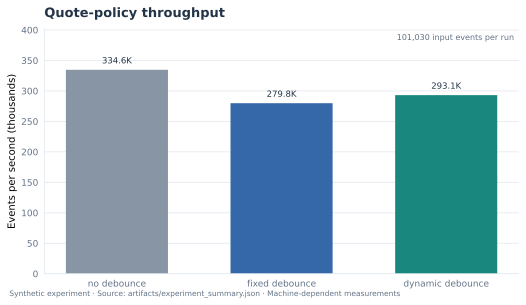
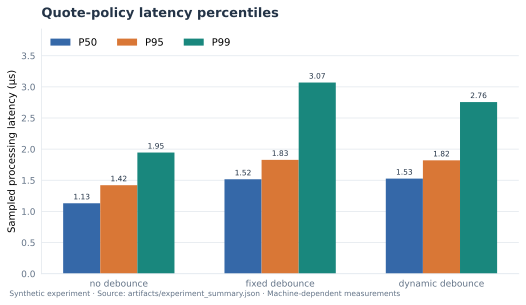
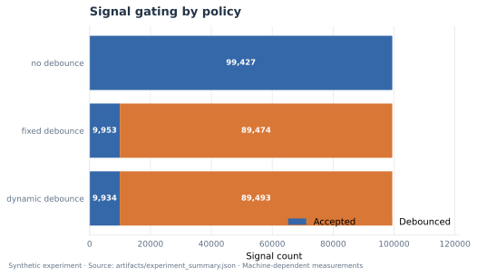
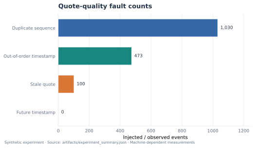
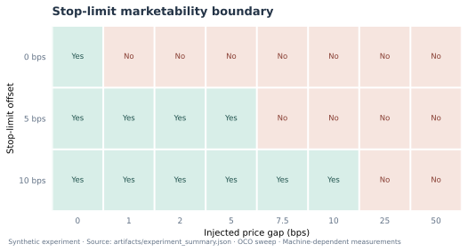
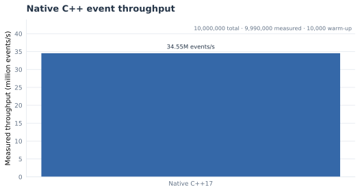
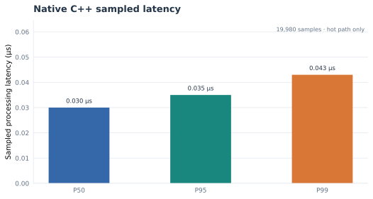
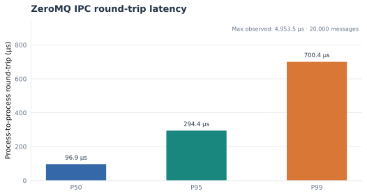

# Sentinel StatArb

**A small market-event test system using C++17, Python, ZeroMQ, and DuckDB.**

Sentinel StatArb tests how fast quote streams behave when they contain repeated messages, old timestamps, stale quotes, and a sudden price gap. It combines a native C++ queue simulation with Python checks for signal control, protective stop-limit orders, message transport, and batch storage.

All examples use synthetic data. The project does not connect to a broker or place live orders.

## At a glance

- **Native C++ engine:** SPSC ring buffer and an event-processing benchmark. The benchmark reports whether its atomics are lock-free on the current machine.
- **Paired GIL comparison:** Runs the same deterministic synthetic quote stream through native C++ and a CPython producer/consumer pipeline, enforces output parity, and measures the throughput ratio after warm-up. The host is recorded; an HPC claim requires a report produced on the HPC machine.
- **Quote checks:** Reject repeated sequence numbers, out-of-order timestamps, stale quotes, and timestamps too far in the future.
- **Dynamic debouncer:** Holds back repeated strategy signals for longer after a sharp price move. Protective order checks still run for every quote that passes the quality checks.
- **OCO stop-limit model:** Tests stop/target behavior and a 5 bps stop-limit offset. A triggered stop-limit order can remain unfilled after a large gap.
- **ZeroMQ bridge:** Sends validated tick messages over IPC or TCP. Native C++ tests measure one-way and round-trip latency separately. ZeroMQ itself is not lock-free, and the saved run did not meet the 10 μs one-way target.
- **Lock-free shared-memory IPC:** A native SPSC ring passes messages between two processes using shared memory. The benchmark checks whether the atomic counters are actually lock-free on the host, verifies sequence order, and measures one-way handoff time.
- **DuckDB writer:** Uses a bounded queue and a separate writer thread. Pandas DataFrame batches reduce per-row insert overhead; read-back checks verify every sequence and quote.
- **Repeatable experiments:** Save CSV/JSON measurements; a simple architecture SVG and eight Matplotlib plots summarize throughput, latency, quote quality, signal gating, and stop-limit boundaries.

## System architecture


## Quick start

Requirements: Python 3.10+, a C++17 compiler, and CMake 3.16+. The native ZeroMQ benchmark is optional and needs the libzmq development package plus pkg-config (for Ubuntu: `sudo apt-get install libzmq3-dev pkg-config`).

```bash
python -m venv .venv
# Linux / macOS
source .venv/bin/activate
# Windows PowerShell: .venv\Scripts\Activate.ps1

python -m pip install --upgrade pip
python -m pip install -e ".[ipc,storage,dev]"
```

Build and test the C++ code:

```bash
cmake -S . -B build -DCMAKE_BUILD_TYPE=Release
cmake --build build --parallel
ctest --test-dir build --output-on-failure
```

Run Python tests and validate the saved reports:

```bash
python -m unittest discover -s tests -v
python scripts/validate_reports.py
```

Run the combined local checks:

```bash
bash scripts/run_checks.sh
```

The combined script runs smaller storage checks by default. Set `SENTINEL_STORAGE_TICKS=10100000` to verify more than 10 million rows locally.

## Repeatable experiments

The experiment script runs one warm-up for each policy, then measures repeated runs and reports the median timing. The timing excludes that policy's warm-up run.

```bash
# Python quote and risk experiment
python scripts/run_experiments.py --ticks 100000 --repeats 3
python scripts/run_experiments.py --ticks 1000000 --repeats 3

# Native C++ benchmark: warm-up run, then measured run
bash scripts/run_cpp_benchmark.sh 1000000 artifacts/cpp_benchmark.json
bash scripts/run_cpp_benchmark.sh 10000000 artifacts/cpp_benchmark_10m.json

# Paired native C++ vs CPython-threaded execution pipeline
python scripts/benchmark_gil_pipeline.py --ticks 1000000 --repeats 3 --out artifacts/gil_comparison_benchmark.json

# Python ZeroMQ process-to-process round trip
python scripts/benchmark_zmq_ipc.py --ticks 20000 --warmup 2000 --out artifacts/zmq_ipc_benchmark.json

# Native C++ ZeroMQ IPC benchmarks (after installing libzmq3-dev and pkg-config)
./build/cpp/sentinel_shm_spsc_ipc_benchmark --messages 200000 --warmup 20000 --capacity 64 --out artifacts/shm_spsc_ipc_benchmark.json
python scripts/run_shm_spsc_capacity_sweep.py --messages 200000 --warmup 20000 --out-dir artifacts
./build/cpp/sentinel_zmq_ipc_oneway_benchmark --messages 20000 --warmup 2000 --out artifacts/cpp_zmq_ipc_oneway_benchmark.json
./build/cpp/sentinel_zmq_ipc_benchmark --messages 20000 --warmup 2000 --out artifacts/cpp_zmq_ipc_benchmark.json

# Separate warm-up and measured DuckDB writes, then verify every row and sequence
python scripts/benchmark_storage.py --ticks 10100000 --batch-size 10000 --out artifacts/stress_ticks.duckdb

# Compare batch sizes using 100K ticks per run
python scripts/run_storage_batch_sweep.py --ticks 100000 --out-dir artifacts

# Generate eight conventional Matplotlib benchmark plots
python scripts/make_plots.py
python scripts/validate_reports.py
```

The DuckDB command writes a separate warm-up database and measured database. It reads the measured database back and checks the row count, distinct sequence count, sequence range, and bid/ask values. It prints progress during both passes. Database files are local test outputs and are not meant to be committed.

GitHub Actions runs the unit tests, native C++ queue tests, 100K quote experiments, 1M and 10M C++ processing benchmarks, native shared-memory and ZeroMQ tests, and real DuckDB write/read-back tests in the regular job. A separate 120-minute job runs the 10M-row DuckDB warm-up and measured passes so the normal 30-minute test limit cannot cancel it. A run is successful only when the report and data checks finish. See [the workflow](.github/workflows/ci.yml).

## Benchmark plots

These eight conventional Matplotlib charts are generated from the checked-in experiment JSON/CSV reports. They show synthetic test behavior; latency and throughput are machine-dependent. Stop-limit marketability is a price condition, not confirmation of an actual fill.

<p align="center">
  
  
</p>
<p align="center">
  
  
</p>
<p align="center">
  
  
</p>
<p align="center">
  
  
</p>

Regenerate them with `python scripts/make_plots.py`. The workflow also regenerates the plots and checks their SVG layout and README references. Machine-readable reports remain the source of truth; the figures are visual summaries, not separate measurements.

## Reading the numbers correctly

The checked-in JSON/CSV files and diagrams are reference runs from synthetic data. Throughput and latency change with the CPU, operating system, compiler, process scheduling, and test settings. Re-run the commands above to produce results for your machine.

### Verification status — latest successful HPC run #9

**[integrator-1 HPC CPU Validation #9 passed on October 14, 2026](https://github.com/SpryzenHell/integrator/actions/runs/38571496094).** It ran on `scn11-mn.mgmt.siddhi.param` (dual AMD EPYC 7742 sockets; 128 physical cores / 256 logical CPUs reported by `lscpu`; A100 GPUs present but not used by this CPU benchmark; Ubuntu 22.04.4, GCC 11.4, CMake 3.22.1, CPython 3.12.15). The Sentinel StatArb source revision was `bd7f72c365fb9d40d2e90ac778cfde1005b68ff8`. The workflow passed 24/24 Python unit/integration tests, 4/4 native CTest tests, every generated report check, and the full 10.1M-row DuckDB write/read-back check.

| Claim area | Latest HPC #9 evidence | What it does not establish |
|---|---|---|
| Native C++ engine | 10M synthetic ticks: **38.68M events/s**, **0.051 μs sampled p99**; zero invalid ticks; queue atomics reported lock-free. | Sampled order/debouncer hot-path timing is not end-to-end market-to-order latency. |
| Python/GIL baseline | Paired 1M-tick pipeline: native C++ **44.57M events/s**, CPython 3.12.15 with GIL enabled **264.57K events/s**; **168.46×** measured throughput ratio and exact semantic parity. | This is whole-pipeline C++ SPSC vs Python `queue.Queue`, not an isolated measurement of GIL overhead. |
| Dynamic debounce under injected crash | In the first 200 sequence slots after a 180 bps price gap, 199 quotes passed quality checks: no debounce accepted 199 entry signals, fixed debounce accepted 20, dynamic debounce accepted **0**. | Simulated entry gating, not realized portfolio exposure, live loss reduction, P&L, or fills. |
| OCO / stop-limit | One protective stop triggered in each policy; after the gap, the 5 bps-offset limit was not marketable. All 24 offset/gap price-boundary cases validated. | Marketability is a price condition, not execution confirmation. |
| Lock-free IPC | Shared-memory SPSC capacity 16: **3.546 μs p50 / 6.452 μs p99**, lock-free atomics and zero sequence/timestamp errors. | Not ZeroMQ; maximum observed latency was 87.586 μs, so a percentile is not a hard upper bound. |
| ZeroMQ | Native one-way p50/p95/p99 **26.249/28.153/33.012 μs**; request/reply p50/p95/p99 **52.229/56.537/62.098 μs**. | ZeroMQ itself is not lock-free and does not meet the sub-10 μs claim. |
| Async DuckDB | **10.1M rows** written and read back; 10.1M unique sequences, range 0–10,099,999, zero invalid rows; **241.7K rows/s** in 41.787 s. | Synthetic data; throughput depends on hardware, CPU scheduling and storage. |

Full run-level details, raw repeats, all capacity settings, quote/risk counts, transport comparisons, source provenance, commands and diagrams are documented below and in [the HPC validation report](docs/HPC_VALIDATION_2026-10-14.md). The persisted [HPC report tree](https://github.com/SpryzenHell/integrator/tree/main/artifacts/sentinel-statarb-hpc) contains JSON/CSV and machine metadata. The A100 was used as the *host*; this was a CPU/IPC/storage workload, not a CUDA acceleration benchmark.

### Engineering outcomes

- **Native event path:** 10M synthetic ticks at 38.68M events/s; sampled hot-path p99 0.051 μs; zero invalid ticks.
- **Paired pipeline:** native C++ median 44.57M events/s versus CPython threaded 264.57K events/s, a measured 168.46× ratio with semantic parity.
- **Risk, transport, and persistence:** dynamic gating accepted 0 of 199 valid entry opportunities in the first 200 post-gap slots; shared-memory SPSC measured 3.546 μs p50 / 6.452 μs p99; 10.1M DuckDB rows passed read-back validation.

## Main files

- `sentinel_runtime/`: Python quote validation, debouncing, risk rules, ZeroMQ bridge, and DuckDB writer
- `cpp/`: C++17 event simulation, process-shared lock-free SPSC ring, ZeroMQ benchmarks, and native tests
- `artifacts/`: reports from the shared-memory queue capacity sweep and the storage checks
- `tests/`: Python unit and integration tests
- `scripts/`: benchmarks, report generation, and report validation
- `artifacts/`: synthetic experiment results in CSV/JSON format
- `docs/assets/`: simple architecture SVG plus eight reproducible Matplotlib plot SVGs

## Author and license

Author: **Pirate-Emperor**.

The project uses the MIT License. See [LICENSE](LICENSE).


---

# Complete experiment ledger (reproducibility record)

This section intentionally records experiment inputs, measurement boundaries, raw result summaries, and limitations in one place. Historical measurements are kept separate by source and run; the plots above visualise the checked-in reference reports and do not replace the experiment ledger.

## A. Run provenance and evidence hierarchy

| Evidence source | Run / revision | Result | Proper use |
|---|---|---|---|
| HPC workflow (historical baseline) | [Run #8](https://github.com/SpryzenHell/integrator/actions/runs/38569070387); source revision 4958b6dde6f8bda5dbbfc4b52b72adb2b64c7d43 | Success | First complete HPC baseline. Retained for run-to-run comparison; superseded by run #9 for the newest crash-window schema. |
| Hosted CI reference run #38571748960 (crash-window schema) | [Run #38571748960](https://github.com/SpryzenHell/sentinel_statarb/actions/runs/38571748960) | Success | Evidence for the new first-200-slot crash-window counters and report generation, plus the shown hosted benchmark values. |
| Latest HPC follow-up | [Run #9](https://github.com/SpryzenHell/integrator/actions/runs/38571496094); Sentinel source `bd7f72c365fb9d40d2e90ac778cfde1005b68ff8` | **Success** | Authoritative latest HPC result: adds post-crash entry-window counters; validates native/Python parity, IPC, risk replay, and 10.1M-row storage on `integrator-1`. |
| Hosted CI raw report artifact | [Run #38571748960 artifacts](https://github.com/SpryzenHell/sentinel_statarb/actions/runs/38571748960) | Published | Contains JSON/CSV output and diagrams for the run. |
| Persisted HPC report tree | [integrator/main/artifacts/sentinel-statarb-hpc](https://github.com/SpryzenHell/integrator/tree/main/artifacts/sentinel-statarb-hpc) | Contains run #9 report files | Host metadata and JSON/CSV measures; `run-status.txt` records success and the exact Sentinel source revision tested. |

The correct evidence hierarchy is: generated JSON plus machine/source provenance first; workflow outcome and logs second; diagrams as a visualization of the JSON, not an independent measurement. A canceled job, partial stress test, or report from a different commit is not a verified result for the current source.

## B. Native event simulation — measurement definitions

The native benchmark uses a C++17 Release build and reports total ticks, warm-up count, measured tick count, throughput, sampled processing latency quantiles, invalid-tick count, and whether its SPSC atomics report lock-free on that host. The shell benchmark helper performs a warm-up invocation before the measured invocation. The later report records a warm-up of 10,000 ticks and excludes those ticks from its measured throughput count.

| Host/run | Input | Measured ticks | Events/s | Sampled p50 | Sampled p95 | Sampled p99 | Invalid ticks | Atomic status |
|---|---:|---:|---:|---:|---:|---:|---:|---|
| HPC #8 | 1,000,000 | 990,000 | 41,833,531 | 0.050 μs | 0.051 μs | 0.060 μs | 0 | Lock-free |
| HPC #8 | 10,000,000 | 9,990,000 | 37,767,022 | 0.050 μs | 0.051 μs | 0.051 μs | 0 | Lock-free |
| HPC #9 | 1,000,000 | 990,000 | 42,623,221 | 0.050 μs | 0.051 μs | 0.051 μs | 0 | Lock-free |
| HPC #9 | 10,000,000 | 9,990,000 | 38,677,888 | 0.040 μs | 0.051 μs | 0.051 μs | 0 | Lock-free |
| Hosted CI #38571748960 | 1,000,000 | 990,000 | 46,080,811 | 0.040 μs | 0.070 μs | 0.071 μs | 0 | Lock-free |
| Hosted CI #38571748960 | 10,000,000 | 9,990,000 | 47,227,394 | 0.050 μs | 0.070 μs | 0.070 μs | 0 | Lock-free |
| Older checked-in reference | 10,000,000 | 9,990,000 | 34,553,787 | 0.030 μs | 0.035 μs | 0.043 μs | 0 | Lock-free |

**Timing boundary:** sampled processing latency times only the native order/debouncer hot path. It is not quote-receive-to-order transmission latency, full simulation wall time, broker latency, or network round trip. The throughput figures include the benchmark’s event pipeline workload and cannot be derived from or equated to one sampled latency quantile.

## C. Paired C++ and CPython threaded pipeline — full method

The paired benchmark exists to measure a complete implementation comparison rather than infer GIL effects from unrelated tests.

1. Construct one deterministic unsigned-64-bit LCG quote/price sequence and identical timestamps for both implementations.
2. Use a bounded producer/consumer path with 65,536 slots: native C++ SPSC versus CPython threading with queue.Queue.
3. Apply matching debounce configuration, stress threshold, stop trigger and stop-limit offset; inject the same large price gap.
4. Run a full warm-up invocation for each implementation.
5. Run repeated measured invocations, alternate implementations to reduce fixed order bias, and summarize throughput/timing with the median.
6. Check exact agreement for total ticks, warm-up and measured counts, accepted/debounced counters, stop count, stop-limit marketability at the gap, invalid-tick count and capacity.
7. Record Python implementation/version, GIL-enabled status, CPU count, binary path, raw repeat values and aggregate throughput ratio in JSON.

| Metric | HPC #8 | Hosted CI #38571748960 |
|---|---:|---:|
| Requested ticks per implementation | 1,000,000 | 1,000,000 |
| Warm-up ticks | 10,000 | 10,000 |
| Measured ticks | 990,000 | 990,000 |
| Native C++ median throughput | 48,794,396 events/s | 45,907,110 events/s |
| Python threaded median throughput | 264,621 events/s | 147,902 events/s |
| Native/Python throughput ratio | **184.39×** | **310.39×** |
| Native sampled processing p50/p95/p99 | 0.040 / 0.051 / 0.051 μs | 0.040 / 0.070 / 0.071 μs |
| Python sampled processing p50/p95/p99 | 1.333 / 1.483 / 1.593 μs | 1.121 / 2.043 / 2.634 μs |
| Accepted / held signals | 99,980 / 900,020 | 99,980 / 900,020 |
| Stop triggers | 1 | 1 |
| Limit marketable after gap | No | No |
| Invalid ticks | 0 | 0 |
| Semantic parity | Pass | Pass |

### Latest HPC follow-up #9

| Metric | HPC #9 |
|---|---:|
| Requested / warm-up / measured ticks per implementation | 1,000,000 / 10,000 / 990,000 |
| Native C++ median throughput | 44,568,909 events/s |
| CPython threaded median throughput (GIL enabled) | 264,571 events/s |
| Measured native/Python pipeline ratio | **168.46×** |
| Native sampled p50/p95/p99 | 0.049 / 0.051 / 0.051 μs |
| Python sampled p50/p95/p99 | 1.362 / 1.483 / 1.583 μs |
| Signals accepted / held (both) | 99,980 / 900,020 |
| Stop triggers / gap marketable / invalid ticks | 1 / No / 0 |
| Semantic parity | Pass |

Exact measured C++ throughput repeats: 35,549,769; 44,568,909; 39,777,890; 51,828,816; and 48,515,768 events/s. Exact Python repeats: 264,571; 261,132; 278,870; 274,915; and 261,877 events/s. Each implementation had one discarded warm-up invocation; the reported median rates yield 168.46×. The source report records CPython 3.12.15 with the GIL enabled.

The ratio is workload-specific and includes the full queue and language path. It combines effects from queue implementation, Python objects/interpreter execution, threading/GIL behavior, compiler optimization, and host scheduling. Do not describe it as a controlled estimate of the GIL’s isolated contribution or as a universal speedup factor.

**Interpretation:** this ratio is workload-specific and includes the full queue and language path. It combines queue implementation, Python objects/interpreter execution, threading/GIL behavior, compiler optimization, and host scheduling. Do not describe it as a controlled estimate of the GIL’s isolated contribution or as a universal speedup factor.

## D. Quote-quality fault injection

The default seeded experiment starts from 100,000 base ticks and inserts repeats, producing 101,030 total input events. The deterministic fault counts and accounting identities are:

| Counter | Count | Meaning |
|---|---:|---|
| Duplicate sequences | 1,030 | Repeated sequence IDs are rejected before they can produce a new strategy signal. |
| Out-of-order timestamps | 473 | A valid event cannot move the engine’s accepted event-time state backward. |
| Stale quotes | 100 | Quote age exceeds the allowed maximum. |
| Future quotes | 0 | This seed does not inject a future timestamp; separate tests cover future-dated rejection. |
| Total quality rejects | 1,603 | 1,030 + 473 + 100. |
| Remaining valid events | 99,427 | 101,030 − 1,603; equals no-debounce accepted signals. |

The quote-health test is designed to prove accounting, not only that a handler returns an error: event categories must sum to the known input total. It also proves the protective order path can still trigger when the strategy signal gate declines a new entry.

## E. Debounce policy comparison and post-crash window

### Whole-stream results

One warm-up run is discarded for each policy; three timed repeats are summarized by the median in hosted CI run #38571748960.

| Policy | Accepted | Held back | Accepted-signal reduction | Events/s | Sampled p50 | p95 | p99 |
|---|---:|---:|---:|---:|---:|---:|---:|
| No debounce | 99,427 | 0 | 0.00% | 360,336 | 1.242 μs | 1.342 μs | 1.492 μs |
| Fixed debounce | 9,953 | 89,474 | 89.99% | 282,367 | 1.993 μs | 2.113 μs | 2.323 μs |
| Dynamic debounce | 9,934 | 89,493 | 90.01% | 284,069 | 1.973 μs | 2.093 μs | 2.264 μs |

The two debounce schemes both reduce full-stream accepted signals substantially. Because the fixed gate already suppresses ordinary repeats, the difference in whole-stream acceptance (9,953 versus 9,934) by itself would not be enough to describe a special crash response. That is why the experiment now emits a separate local window counter.

### Latest HPC whole-stream policy measurements (run #9)

| Policy | Accepted | Held back | Accepted-signal reduction | Events/s | Sampled p50 | p95 | p99 |
|---|---:|---:|---:|---:|---:|---:|---:|
| No debounce | 99,427 | 0 | 0.00% | 303,175 | 1.533 μs | 1.723 μs | 1.763 μs |
| Fixed debounce | 9,953 | 89,474 | 89.99% | 219,932 | 2.535 μs | 2.696 μs | 2.856 μs |
| Dynamic debounce | 9,934 | 89,493 | 90.01% | 220,609 | 2.545 μs | 2.845 μs | 2.966 μs |

Run #9 used seed `20261011`, 100,000 base ticks plus 1,030 duplicated input events (101,030 total), 10,000 ns timestamp spacing, a crash at sequence 55,000, a 180 bps price gap, one warm-up per policy and three measured repeats. The above throughput and latency are from that HPC host and are machine-dependent.
### First 200 sequence slots at the crash

The price drops by 180 bps at sequence 55,000 (55% of the 100,000 base stream). The first 200 sequence slots include 199 quotes that pass quality checks.

| Policy | Valid quote count | Accepted entry signals | Held back | Accepted fraction |
|---|---:|---:|---:|---:|
| No debounce | 199 | 199 | 0 | 100.00% |
| Fixed debounce | 199 | 20 | 179 | 10.05% |
| Dynamic debounce | 199 | 0 | 199 | 0.00% |

This demonstrates the expected local policy behavior under that deterministic timing/price input. It does not prove financial damage was avoided. The model tracks entry-signal allowance and protective order state; it does not calculate a live portfolio’s net exposure or fills.

A further regression check requires the post-crash counts to reconcile (valid equals accepted plus held back), all policies to inspect the same window size, and accepted-entry count to decrease from no-debounce to fixed to dynamic. The SVG snapshot is generated from these report fields.

## F. OCO stop-limit tests and 24-case gap matrix

Standard execution setup: long position reference price 100, 25 bps stop, and 5 bps offset. The grid checks offsets 0/5/10 bps against 0/1/2/5/7.5/10/25/50 bps post-trigger price gaps.

| Offset | 0 bps gap | 1 bps | 2 bps | 5 bps | 7.5 bps | 10 bps | 25 bps | 50 bps |
|---:|---:|---:|---:|---:|---:|---:|---:|---:|
| 0 bps | Marketable | Not marketable | Not marketable | Not marketable | Not marketable | Not marketable | Not marketable | Not marketable |
| 5 bps | Marketable | Marketable | Marketable | Marketable | Not marketable | Not marketable | Not marketable | Not marketable |
| 10 bps | Marketable | Marketable | Marketable | Marketable | Marketable | Marketable | Not marketable | Not marketable |

Tests assert the price-boundary arithmetic, order direction, invalid offset rejection, one-shot OCO firing, risk checks even when debounce holds an entry, and unmarketable state after the 180 bps gap. “Marketable” is a simple price condition, not execution confirmation.

## G. Lock-free shared-memory SPSC — all measured capacities

The shared-memory SPSC experiment uses distinct producer and consumer processes sharing memory. It samples producer timestamp through consumer pop on the same host monotonic clock, performs a payload/sequence check, checks the relevant atomics for lock-free support and reports all latency percentiles. Each capacity uses a fresh pair, 20,000 warm-ups, and 200,000 measured messages.

### HPC run #8

| Capacity | p50 | p95 | p99 | Max observed | Throughput | Sequence/time errors |
|---:|---:|---:|---:|---:|---:|---|
| 16 | 3.397 μs | 3.887 μs | 6.102 μs | 1,428.499 μs | 2,481,100 msg/s | 0 |
| 64 | 7.434 μs | 10.500 μs | 12.172 μs | 644.894 μs | 4,752,715 msg/s | 0 |
| 256 | 24.386 μs | 28.254 μs | 30.127 μs | 819.865 μs | 6,456,455 msg/s | 0 |
| 1,024 | 90.661 μs | 107.935 μs | 112.243 μs | 173.168 μs | 7,106,096 msg/s | 0 |

### Latest HPC follow-up #9

| Capacity | p50 | p95 | p99 | Max observed | Throughput | Sequence/time errors |
|---:|---:|---:|---:|---:|---:|---|
| 16 | 3.546 μs | 4.158 μs | 6.452 μs | 87.586 μs | 2,409,717 msg/s | 0 |
| 64 | 7.384 μs | 9.929 μs | 11.692 μs | 40.487 μs | 4,929,058 msg/s | 0 |
| 256 | 24.076 μs | 27.922 μs | 29.877 μs | 123.985 μs | 6,660,278 msg/s | 0 |
| 1,024 | 87.225 μs | 103.837 μs | 111.461 μs | 256.076 μs | 7,346,939 msg/s | 0 |

Standalone capacity 64 in this same run: p50/p95/p99 = 7.173/10.089/11.943 μs, maximum 52.089 μs, 5,016,578 messages/s, 200,000 measured messages after 20,000 warm-ups. Every setting reported lock-free atomics and zero bad sequences/invalid timestamps.
### Hosted-CI sweep

| Capacity | p50 | p95 | p99 | Max observed | Throughput | Sequence/time errors |
|---:|---:|---:|---:|---:|---:|---|
| 16 | 0.987 μs | 1.247 μs | 2.329 μs | 88.709 μs | 10,420,587 msg/s | 0 |
| 64 | 5.022 μs | 6.475 μs | 16.831 μs | 121.639 μs | 10,504,364 msg/s | 0 |
| 256 | 22.168 μs | 25.904 μs | 57.612 μs | 84.523 μs | 10,703,923 msg/s | 0 |
| 1,024 | 88.328 μs | 172.064 μs | 220.317 μs | 286.317 μs | 9,545,609 msg/s | 0 |

Every setting reported lock-free atomics and zero sequence/timestamp errors. Capacity 16 gave the lowest p50 and p99 in both runs. The high maximum observed at HPC capacity 16 and differences between hosts show that percentiles are not a hard latency bound. The ring capacity changes queueing and cache/scheduling behavior; it is not safe to tune from p50 alone.

### Standalone capacity-64 measurements

| Host | p50 | p95 | p99 | Throughput | Measured messages |
|---|---:|---:|---:|---:|---:|
| HPC run #8 | 7.584 μs | 10.620 μs | 12.263 μs | 4,762,943 msg/s | 200,000 |
| Hosted CI | 5.102 μs | 6.315 μs | 7.787 μs | See raw JSON | 200,000 |

The capacity-64 standalone result and capacity-64 sweep may differ because the sender/receiver process pair, scheduler and backlog differ between test invocations. Use each report’s own metrics.

## H. ZeroMQ — complete separate transport results

ZeroMQ uses IPC sockets and is **not lock-free**. The paced native one-way benchmark puts a timestamp in a message and waits for acknowledgment so it does not accumulate an unbounded sender backlog. The request/reply round-trip benchmark measures a different interval.

| Host / implementation | Measurement | p50 | p95 | p99 | Notes |
|---|---|---:|---:|---:|---|
| HPC C++ | One-way | 25.999 μs | 27.863 μs | 31.009 μs | 20K measured; payload verified; not lock-free |
| HPC C++ | ACK RTT | 51.448 μs | — | 60.535 μs | Mean 53.183 μs |
| HPC C++ | Request/reply RTT | 51.398 μs | 56.848 μs | 61.456 μs | ~18,852 RTT/s |
| HPC Python | Request/reply RTT | 61.957 μs | 67.007 μs | 72.938 μs | Includes Python/scheduler overhead |
| Hosted C++ | One-way | 36.940 μs | 47.121 μs | 65.884 μs | Payload verified |
| Hosted C++ | Request/reply RTT | 73.932 μs | 92.359 μs | 108.054 μs | Not lock-free |
| Hosted Python | Request/reply RTT | 81.684 μs | 101.323 μs | 147.463 μs | Process-to-process |

### Latest HPC follow-up #9

| Native ZeroMQ metric | p50 | p95 | p99 | Maximum / notes |
|---|---:|---:|---:|---|
| One-way IPC | 26.249 μs | 28.153 μs | 33.012 μs | Max 7,133.287 μs; 20,000 payload-checked messages; not lock-free |
| Per-message ACK round trip | 51.878 μs | — | 63.601 μs | Mean 56.280 μs; paced serial RTT ~17,533/s |
| Request/reply RTT | 52.229 μs | 56.537 μs | 62.098 μs | Max 8,012.785 μs; ~18,395 RTT/s |
| Python process-to-process RTT | 61.516 μs | 66.587 μs | 73.099 μs | Mean 64.739 μs; payload check passed |

Historical native reference: one-way p50/p95/p99 56.513/63.731/67.720 μs and ACK RTT p50 111.148 μs. These historical values also miss the target. They are retained for provenance and are not substituted for the current runs.

Do not combine the shared-memory SPSC numbers with ZeroMQ numbers: they are separate transports and measure different event intervals.

## I. DuckDB batch and full persistence experiments

### Batch sweep (hosted CI run #38571748960)

Each batch size gets a warm-up run/database and separate measured write/read-back database, 100,000 requested rows per setting.

| Batch size | Elapsed | Rows/s | Rows read back | Unique IDs | Invalid quotes |
|---:|---:|---:|---:|---:|---:|
| 1,000 | 566.520 ms | 176,516 | 100,000 | 100,000 | 0 |
| 10,000 | 299.870 ms | 333,478 | 100,000 | 100,000 | 0 |
| 50,000 | 280.546 ms | 356,448 | 100,000 | 100,000 | 0 |

50K batching showed about 2.02× the throughput of 1K batching in this sweep, but there was one measured run per setting. It is a tuning signal, not a confidence interval.

### Full stress run

| Metric | HPC #8 (historical) | Hosted full job #38571748960 | HPC #9 (latest) |
|---|---:|---:|---:|
| Warm-up rows | 10,100,000 | 10,100,000 | 10,100,000 |
| Measured rows requested | 10,100,000 | 10,100,000 | 10,100,000 |
| Rows written by logger | 10,100,000 | 10,100,000 | 10,100,000 |
| Rows read back | 10,100,000 | 10,100,000 | 10,100,000 |
| Distinct sequence IDs | 10,100,000 | 10,100,000 | 10,100,000 |
| Sequence range | 0–10,099,999 | 0–10,099,999 | 0–10,099,999 |
| Invalid bid/ask rows | 0 | 0 | 0 |
| Measured elapsed | 41,789.149 ms | 34,939.460 ms | 41,786.738 ms |
| Throughput | 241,689.538 rows/s | 289,071.441 rows/s | 241,703.477 rows/s |
| Database size | 136,065,024 bytes | 136,065,024 bytes | 136,065,024 bytes |

The 100K smoke run in hosted CI #38571748960 additionally read back 100,000/100,000 rows, all IDs unique from 0–99,999, zero invalid quotes and 317,611 rows/s. The full test verifies both the logger’s output counter and the persisted database, including full uniqueness/range/quote checks.

## J. Reproduction commands by experiment

### Environment setup

```bash
python -m venv .venv
source .venv/bin/activate
python -m pip install --upgrade pip
python -m pip install -e ".[ipc,storage,dev]"
sudo apt-get install -y libzmq3-dev pkg-config
```

### Unit tests, static checks and native tests

```bash
python -m compileall -q sentinel_runtime scripts tests
python -m unittest discover -s tests -v
cmake -S . -B build -DCMAKE_BUILD_TYPE=Release
cmake --build build --parallel
ctest --test-dir build --output-on-failure
python scripts/validate_reports.py
```

### Quote policy, crash window and OCO matrix

```bash
python scripts/run_experiments.py --ticks 100000 --repeats 3 --out artifacts
python scripts/make_plots.py
python scripts/validate_reports.py
```

### Native C++ and paired GIL benchmark

```bash
bash scripts/run_cpp_benchmark.sh 1000000 artifacts/cpp_benchmark.json
bash scripts/run_cpp_benchmark.sh 10000000 artifacts/cpp_benchmark_10m.json
python scripts/benchmark_gil_pipeline.py --ticks 1000000 --repeats 3 --out artifacts/gil_comparison_benchmark.json
python scripts/validate_reports.py
```

### Shared-memory and ZeroMQ IPC

```bash
./build/cpp/sentinel_shm_spsc_ipc_benchmark --messages 200000 --warmup 20000 --capacity 64 --out artifacts/shm_spsc_ipc_benchmark.json
python scripts/run_shm_spsc_capacity_sweep.py --messages 200000 --warmup 20000 --out-dir artifacts

./build/cpp/sentinel_zmq_ipc_oneway_benchmark --messages 20000 --warmup 2000 --out artifacts/cpp_zmq_ipc_oneway_benchmark.json
./build/cpp/sentinel_zmq_ipc_benchmark --messages 20000 --warmup 2000 --out artifacts/cpp_zmq_ipc_benchmark.json
python scripts/benchmark_zmq_ipc.py --ticks 20000 --warmup 2000 --out artifacts/zmq_ipc_benchmark.json
python scripts/make_plots.py
python scripts/validate_reports.py
```

### Storage sweeps and stress test

```bash
python scripts/run_storage_batch_sweep.py --ticks 100000 --out-dir artifacts
python scripts/benchmark_storage.py --ticks 10100000 --batch-size 10000 --out artifacts/stress_ticks.duckdb
python scripts/make_plots.py
python scripts/validate_reports.py
```

Database binaries are local outputs; commit the source, scripts and small JSON/CSV/SVG summaries—not the 136 MB-class DuckDB test database.

## K. Figures and report index

- [System path and subsystem boundaries](docs/assets/architecture.svg)
- [Quote-policy throughput](docs/assets/policy-throughput.svg)
- [Stop-limit price-gap boundary](docs/assets/stop-limit-gap-boundary.svg)
- [Detailed methods and historical reference measurements](docs/EXPERIMENTS.md)
- [HPC host provenance and complete validation record](docs/HPC_VALIDATION_2026-10-14.md)

## L. Evidence limits and reporting guardrails

- The 168.46× figure compares complete C++ SPSC and CPython `queue.Queue` pipelines. It is workload-specific and is not an isolated estimate of GIL overhead.
- The 90.01% whole-stream signal reduction and the 0/199 local-window result are synthetic entry-gating observations, not realized P&L, live exposure reduction, or proof of improved trading outcomes.
- The low-latency IPC measurement is **shared-memory SPSC**, not ZeroMQ. ZeroMQ measurements are reported separately and do not support a lock-free or sub-10 μs characterization.
- p50/p99 values describe observed percentiles, not hard upper bounds. A stop-limit becoming marketable is not evidence that it filled.
- The A100 was present on the HPC host but was not used by these CPU, IPC, or storage experiments.
- Source revision, host details, warm-up policy, raw repetitions, and artifact provenance are retained alongside each result. Failed or canceled runs and incomplete read-back checks are not treated as successful measurements.

## M. Known workflow incidents and chronology

| Run / iteration | Outcome | Lesson / resolution |
|---|---|---|
| Initial HPC workflow attempts #1–#6 | Cancelled during workflow development | Workflow/configuration was changing; do not treat them as measurements. |
| HPC #7 | Failed before native benchmarks | Cleanup removed experiment_summary.json before a fixture-dependent Python test; cleanup was moved after unit tests. |
| HPC #8 | **Success** | First full test matrix, baseline measurements and report validation. Kept as historical comparison. |
| Hosted crash-window development iteration | One failure, then later success | Unit tests caught a missing base-tick argument on measured repeat runs; it was fixed before later report generation passed. |
| HPC #9 | [Dedicated follow-up run](https://github.com/SpryzenHell/integrator/actions/runs/38571496094) | **Success**; tested the crash-window schema on integrator-1, passed all validators and full storage read-back; persisted current reports under `integrator/main/artifacts/sentinel-statarb-hpc`. |

The benchmark outputs are tied to source revision and machine provenance. Canceled/failed runs and incomplete storage read-back are not successful evidence. This ledger records passing checks and limitations so the results can be reproduced and interpreted correctly.


## N. Hosted-CI run #38577287975 — supplemental measurements

**Status:** success · **Commit tested:** 84fa009368c73d2dc0f1a6ab428668b038ca65e0 · **[Workflow page and artifacts](https://github.com/SpryzenHell/sentinel_statarb/actions/runs/38577287975)**.

This run validates the expanded README-linked SVG/report changes on the repository’s main branch. Both workflow jobs passed: the regular job and the separate 10.1M-row DuckDB stress job. Python tests passed **25/25**, native CTest passed **4/4**, and all generated report/CSV/SVG checks passed. These measurements are a newer hosted-run snapshot and are recorded separately from hosted run #385717 and HPC run #8 because timings vary materially between runners.

### Native C++ and paired Python results

| Measurement | Latest hosted CI #385772 |
|---|---:|
| Native C++ 1M ticks throughput | 31,622,567 events/s |
| Native C++ 1M sampled p50/p95/p99 | 0.050 / 0.051 / 0.060 μs |
| Native C++ 10M ticks throughput | 30,916,365 events/s |
| Native C++ 10M sampled p50/p95/p99 | 0.050 / 0.060 / 0.071 μs |
| Native invalid ticks | 0 |
| Paired native C++ median throughput | 32,148,828 events/s |
| Paired GIL-enabled CPython threaded median throughput | 127,491 events/s |
| Paired pipeline throughput ratio | **252.17×** |
| Paired native sampled p50/p95/p99 | 0.050 / 0.051 / 0.060 μs |
| Paired Python sampled p50/p95/p99 | 1.463 / 3.186 / 5.049 μs |
| Accepted / held signals in paired workload | 99,980 / 900,020 in both implementations |
| Stop triggers and marketability | 1 trigger each; stop-limit not marketable at injected gap |
| Parity checks | Pass; no invalid ticks |

The native throughput and ratio are lower/different than in other runs. This is not a contradiction: the runner is a four-logical-CPU GitHub hosted VM for this paired run, whereas HPC #8 used an AMD EPYC server. The host/workload result must travel with the number.

The exact raw throughput repeats in this run were 32,399,548, 31,741,759 and 32,148,828 events/s for C++; 127,855, 118,807 and 127,491 events/s for the CPython threaded pipeline. The report used three measured repeats after a warm-up invocation for each implementation.

### Signal policy and crash window

| Policy | Accepted full-stream signals | Held back | Throughput | Sampled p50/p95/p99 |
|---|---:|---:|---:|---:|
| No debounce | 99,427 | 0 | 275,190 events/s | 1.653 / 1.783 / 1.893 μs |
| Fixed debounce | 9,953 | 89,474 | 214,080 events/s | 2.645 / 2.806 / 3.105 μs |
| Dynamic debounce | 9,934 | 89,493 | 214,130 events/s | 2.655 / 2.815 / 3.086 μs |

The post-crash observation window reconciles correctly in both hosted CI and HPC run #9: 199 valid quotes; no debounce accepted 199; fixed debounce accepted 20 and held 179; dynamic debounce accepted zero and held all 199. All three policies triggered the protective stop once and the stop-limit was not marketable at the 180 bps gap. The 24-case 0/5/10 bps offset matrix also passed report validation.


### Shared-memory SPSC latest hosted measurements

Standalone capacity 64:

| Metric | Result |
|---|---:|
| p50 | 3.876 μs |
| p95 | 5.899 μs |
| p99 | 6.411 μs |
| Mean / maximum | 4.140 / 31.297 μs |
| Throughput | 14,019,304 messages/s |
| Measured messages | 200,000 |
| Atomics lock-free | Yes |
| Bad sequences / invalid timestamps | 0 / 0 |

Capacity sweep (20,000 warm-ups plus 200,000 measured messages at every capacity):

| Capacity | p50 | p95 | p99 | Maximum | Throughput |
|---:|---:|---:|---:|---:|---:|
| 16 | 1.110 μs | 1.461 μs | 2.763 μs | 20.827 μs | 9.871M msg/s |
| 64 | 4.907 μs | 6.600 μs | 9.566 μs | 33.431 μs | 11.196M msg/s |
| 256 | 17.865 μs | 18.847 μs | 31.761 μs | 45.306 μs | 14.098M msg/s |
| 1,024 | 84.806 μs | 103.212 μs | 114.873 μs | 118.830 μs | 11.640M msg/s |

Every capacity reported lock-free atomics and zero sequence/timestamp errors. Capacity 16 again gave the lowest latency percentiles; capacity 256 had the highest throughput in this hosted run but substantially worse tail latency. These are measurements of shared-memory SPSC, not ZeroMQ.

### ZeroMQ latest hosted results

| Path | p50 | p95 | p99 | Additional evidence |
|---|---:|---:|---:|---|
| Native C++ one-way | 59.912 μs | 67.257 μs | 73.486 μs | Mean 59.053 μs, max 145.193 μs; no bad payloads |
| Native C++ ACK RTT in paced test | 119.453 μs | — | 145.032 μs | ZeroMQ transport is not lock-free |
| Native C++ request/reply RTT | 113.021 μs | 131.907 μs | 138.780 μs | 8,719.294 RTT/s |
| Python process-to-process RTT | 137.858 μs | 150.211 μs | 165.089 μs | Mean 137.874 μs; payload check passed |

This run’s ZeroMQ numbers are slower than earlier hosted/HPC runs. No sub-10 μs ZeroMQ claim is supported by any of these reports, and the transport remains non-lock-free.

### Storage sweep and full read-back from this run

The quick smoke test validated 100,000 rows, 100,000 distinct sequences spanning 0–99,999, zero invalid quotes and measured 282,375 rows/s.

| Batch size | 100K rows elapsed | Throughput | Rows read back | Invalid quotes |
|---:|---:|---:|---:|---:|
| 1,000 | 746.745 ms | 133,914 rows/s | 100,000 | 0 |
| 10,000 | 389.031 ms | 257,049 rows/s | 100,000 | 0 |
| 50,000 | 361.346 ms | 276,743 rows/s | 100,000 | 0 |

Full stress job:

| Check | Run #385772 result |
|---|---:|
| Warm-up pass | 10,100,000 rows |
| Separate measured pass | 10,100,000 rows |
| Rows written and read back | 10,100,000 / 10,100,000 |
| Distinct sequences | 10,100,000 |
| Sequence range | 0–10,099,999 |
| Invalid quote rows | 0 |
| Measured elapsed | 36,550.997 ms |
| Throughput | 276,326.249 rows/s |
| Database size | 136,065,024 bytes |

All row-readback and report validator checks passed. This result is deliberately kept separate from the 34.939-second hosted run #385717 and the 41.789-second HPC run #8.

### How this updates the evidence

Run #385772 completes the regression pass for the expanded README and new snapshot. It does not replace the HPC evidence; it adds a newer hosted-CI sample with its own runner, throughput, and IPC distributions. The authoritative HPC figures remain run #8 until the dedicated HPC #9 post-crash follow-up completes successfully.


## O. Hosted-CI run #38578317893 — documentation-commit verification snapshot

**Outcome: success** · **Commit tested:** 0a03826bfa15381543bf48e5bcb246dd3b74a3c2 · [Run #38578317893](https://github.com/SpryzenHell/sentinel_statarb/actions/runs/38578317893).

This run validates the README commit above, including the 604-line report and all referenced figures. The regular CI job passed **25 Python tests**, **4/4 native CTest tests**, paired-benchmark semantic checks, IPC payload/sequence checks, the batch sweep, SVG generation and report validation. The separate full-scale storage job passed too. These are the exact measurements for this run; they are recorded separately because host scheduling and throughput vary across CI invocations.

### C++ and paired pipeline

| Metric | Run #38578317893 |
|---|---:|
| Native C++ 1M throughput | 44,612,616 events/s |
| Native C++ 1M sampled p50/p95/p99 | 0.040 / 0.070 / 0.071 μs |
| Native C++ 10M throughput | 47,072,961 events/s |
| Native C++ 10M sampled p50/p95/p99 | 0.050 / 0.070 / 0.070 μs |
| Native invalid ticks | 0 |
| Paired C++ median throughput | 45,399,212 events/s |
| Paired CPython threaded median throughput | 147,680 events/s |
| Paired measured throughput ratio | **307.42×** |
| Paired native sampled p50/p95/p99 | 0.040 / 0.070 / 0.070 μs |
| Paired Python sampled p50/p95/p99 | 1.122 / 2.083 / 2.584 μs |
| Accepted / held signals in paired pipeline | 99,980 / 900,020 for both |
| Stop outcome and invalid input | One stop trigger; post-gap limit not marketable; zero invalid ticks |
| Semantic parity | Pass |

The three measured paired C++ throughput repetitions for run #385783 were 45,399,212; 44,558,458; and 45,746,047 events/s. The corresponding CPython threaded repetitions were 145,112; 154,941; and 147,680 events/s. Their medians are 45,399,212 and 147,680 events/s respectively, yielding the reported 307.42× ratio. Keep these raw rates attached to run #385783 rather than mixing them with repetitions from earlier CI runs.

### Quote/risk results

| Policy | Full-stream accepted | Held back | Throughput | Sampled p50/p95/p99 |
|---|---:|---:|---:|---:|
| No debounce | 99,427 | 0 | 355,821 events/s | 1.282 / 1.382 / 1.472 μs |
| Fixed debounce | 9,953 | 89,474 | 282,113 events/s | 2.003 / 2.163 / 2.283 μs |
| Dynamic debounce | 9,934 | 89,493 | 281,556 events/s | 2.003 / 2.173 / 2.303 μs |

In the first 200 crash-window sequence slots, 199 quotes passed quality checks. No debounce accepted 199 entries, fixed debounce accepted 20, and dynamic debounce accepted 0. All policies recorded one protective stop trigger and a not-marketable stop-limit after the 180 bps gap. The 24-case OCO gap matrix passed report validation.

### Shared-memory IPC in run #385783

Standalone capacity 64:

| Metric | Result |
|---|---:|
| p50 | 4.762 μs |
| p95 | 5.853 μs |
| p99 | 8.107 μs |
| Maximum observed | 23.880 μs |
| Throughput | 11,938,291 messages/s |
| Measured / warm-up messages | 200,000 / 20,000 |
| Lock-free atomics | Yes |
| Sequence / timestamp errors | 0 / 0 |

Capacity sweep:

| Capacity | p50 | p95 | p99 | Throughput |
|---:|---:|---:|---:|---:|
| 16 | 0.912 μs | 1.153 μs | 2.283 μs | 11.424M msg/s |
| 64 | 4.642 μs | 5.914 μs | 6.816 μs | 11.862M msg/s |
| 256 | 20.886 μs | 22.668 μs | 32.322 μs | 11.843M msg/s |
| 1,024 | 82.536 μs | 92.741 μs | 95.124 μs | 12.189M msg/s |

All capacities had lock-free atomics and zero sequence/timestamp errors. Capacity 16 gave the lowest tail latency; capacity 1,024 had the highest throughput in this run and a much slower p99.

### ZeroMQ in run #385783

| Path | p50 | p95 | p99 | Notes |
|---|---:|---:|---:|---|
| Native C++ one-way | 39.753 μs | 53.809 μs | 84.404 μs | 20K messages; payload check passed |
| Native C++ ACK RTT | 79.467 μs | — | 138.935 μs | Transport is not lock-free |
| Native C++ request/reply RTT | 77.304 μs | 111.634 μs | 137.443 μs | 12,295 RTT/s |
| Python process-to-process RTT | 85.356 μs | 118.886 μs | 142.260 μs | Payload integrity passed |

All remain above the sub-10 μs one-way target. They are separate from the shared-memory SPSC figures.

### Storage in run #385783

| Test | Elapsed | Throughput | Rows read back | Invalid rows |
|---|---:|---:|---:|---:|
| 100K smoke test | 712.316 ms | 140,387 rows/s | 100,000 | 0 |
| 100K batch size 1K | 780.258 ms | 128,163 rows/s | 100,000 | 0 |
| 100K batch size 10K | 372.298 ms | 268,602 rows/s | 100,000 | 0 |
| 100K batch size 50K | 297.679 ms | 335,932 rows/s | 100,000 | 0 |
| 10.1M full measured pass | 39,610.724 ms | 254,981 rows/s | 10,100,000 | 0 |

For the full stress run, the separate warm-up pass also wrote and read back 10,100,000 unique rows; measured pass rows requested/written/read back were all 10,100,000, with unique sequence range 0–10,099,999 and database size 136,065,024 bytes. Full-scale validator checks passed. The result is host/run-specific and is distinct from the 36.551-second storage pass in hosted run #385772, the 34.939-second pass in #385717, and the 41.789-second HPC run #8.

## P. Current HPC follow-up status — completed

**Status as of October 14, 2026: success.** HPC run #9 ([workflow run](https://github.com/SpryzenHell/integrator/actions/runs/38571496094)) completed at 14:26 UTC and its machine-readable reports were committed to [`integrator/main/artifacts/sentinel-statarb-hpc`](https://github.com/SpryzenHell/integrator/tree/main/artifacts/sentinel-statarb-hpc). `run-status.txt` states `workflow_outcome=success` and identifies the tested Sentinel StatArb source revision as `bd7f72c365fb9d40d2e90ac778cfde1005b68ff8`.

The run was on `scn11-mn.mgmt.siddhi.param`, a dual-socket AMD EPYC 7742 host exposing 256 logical CPUs. Software recorded: Ubuntu 22.04.4 LTS, Linux 5.15, GCC 11.4.0, CMake 3.22.1 and CPython 3.12.15 with the GIL enabled. A100 hardware was present, but the benchmark intentionally used the CPU only.

Passed checks: 24 Python tests, 4 native CTest targets, both 1M/10M native C++ baselines, five-repeat paired C++/Python parity comparison, standalone and four-capacity shared-memory SPSC measurements, C++ and Python ZeroMQ payload checks, the 100K quote/OCO experiment with crash-window accounting, the three-way DuckDB batch sweep, the 10.1M-row warm-up and measured storage passes, and full JSON/CSV/SVG validation.

See the next section for the complete current-run table and raw repetition values. Previous HPC run #8 and hosted CI runs #385717, #385772 and #385783 remain in the ledger for historical comparison; their numbers must not be mixed into the #9 report.

## Q. HPC run #9 — full experiment record

### Q1. Provenance, setup and measurement discipline

- **Workflow:** [Sentinel StatArb HPC CPU Validation #9](https://github.com/SpryzenHell/integrator/actions/runs/38571496094), success.
- **Code under test:** Sentinel StatArb commit `bd7f72c365fb9d40d2e90ac778cfde1005b68ff8`; workflow configuration commit `42bdbf5896a1ed596621fd23bdfc3352c82e3199`.
- **Host:** `scn11-mn.mgmt.siddhi.param`; AMD EPYC 7742 dual socket, 64 cores/socket and 2 threads/core (128 physical cores / 256 logical CPUs); Ubuntu 22.04.4; Linux kernel 5.15.0-1062-nvidia.
- **Compiler/build:** GCC 11.4.0; CMake 3.22.1; Release build. The native targets were compiled from this run's checkout.
- **Python:** CPython 3.12.15; paired report confirms `python_gil_enabled=true`.
- **GPU:** NVIDIA A100 GPUs and driver 550.90.07 / CUDA 12.4 were reported by `nvidia-smi`; no CUDA kernel or GPU compute was used by this CPU/IPC/storage workload.
- **Test result:** 24 Python tests passed; CTest 4/4 passed; `validate_reports.py` completed with `All report checks passed.`; full storage validator required at least 10,000,001 persisted rows and passed.

Measurement rules applied throughout: each script's explicit warm-up was discarded; C++ 1M/10M reports exclude 10,000 warm-up ticks; paired benchmark discarded one full invocation per implementation and summarized five measured runs using medians; IPC used 20,000 warm-up and 200,000 measured messages (per capacity); ZeroMQ used 2,000 warm-up and 20,000 measured messages; storage used a separate 10.1M-row warm-up DB and measured DB, then read the entire measured DB back.

### Q2. Native C++ throughput and sampled processing latency

| Metric | 1M-tick run | 10M-tick run |
|---|---:|---:|
| Total requested ticks | 1,000,000 | 10,000,000 |
| Warm-up ticks | 10,000 | 10,000 |
| Measured ticks | 990,000 | 9,990,000 |
| Throughput | 42,623,220.72 events/s | 38,677,888.04 events/s |
| Sampled p50 | 0.050 μs | 0.040 μs |
| Sampled p95 | 0.051 μs | 0.051 μs |
| Sampled p99 | 0.051 μs | 0.051 μs |
| Timed processing samples | 19,800 | 19,980 |
| Invalid ticks | 0 | 0 |
| Accepted / debounced | 99,980 / 900,020 | 999,980 / 9,000,020 |
| Stop triggers | 1 | 1 |
| Limit marketable after injected gap | No | No |
| SPSC atomics report lock-free | Yes | Yes |

The native JSON calls the executable `sentinel_cpp_simulation`. Throughput is the measured event pipeline rate. Sampled processing latency measures the hot order/debounce work only; it is not full pipeline latency, network/broker latency, or quote-to-order time.


### Q3. Paired native C++ vs CPython queue pipeline — complete record

Workload: 1,000,000 identical seeded ticks per implementation; same LCG stream and bounded noise; one injected 180 bps gap; 65,536 queue slots; timestamp step 10,000 ns; 100 μs base / 2 ms maximum debounce cooldown; 5 bps stress threshold; 25 bps stop and 5 bps offset. Native uses C++ SPSC; baseline uses a CPython producer thread, bounded `queue.Queue` and project Python risk logic. One full invocation per implementation was discarded, then five runs were measured.

| Metric | Native C++ | CPython threaded |
|---|---:|---:|
| Median throughput | 44,568,909.25 events/s | 264,571.456 events/s |
| Sampled p50 | 0.049 μs | 1.362 μs |
| Sampled p95 | 0.051 μs | 1.483 μs |
| Sampled p99 | 0.051 μs | 1.583 μs |
| Latency sample count / measured run | 19,800 | 19,800 |
| Accepted signals | 99,980 | 99,980 |
| Debounced signals | 900,020 | 900,020 |
| Stop triggers | 1 | 1 |
| Stop-limit marketable at gap | false | false |
| Invalid ticks | 0 | 0 |
| Queue capacity | 65,536 | 65,536 |
| Queue atomics lock-free | true | false (Python queue baseline) |

**Median throughput ratio = 168.45698×.** Semantic-parity checks passed for tick total, warm-up and measured counts, accepted/debounced signals, stop count, stop-limit marketability, invalid ticks and capacity.

Raw C++ measured rates (events/s): 35,549,769.28; 44,568,909.25; 39,777,889.91; 51,828,816.43; 48,515,767.89. Raw Python rates (events/s): 264,571.456; 261,131.542; 278,869.628; 274,915.399; 261,877.269. The Python implementation retained its GIL; the benchmark attributes the result to the complete pipeline comparison rather than to the GIL in isolation.

### Q4. Synthetic quote quality, debounce and crash response

Input generation: seed `20261011`; 100,000 base ticks and 1,030 inserted duplicate-sequence events, yielding 101,030 total input events. Timestamps advance in 10,000 ns steps. The price drops 180 bps at sequence 55,000 (55% of the base stream). Each policy has one warm-up run and three measured repetitions.

| Quote-quality counter (per policy) | Count |
|---|---:|
| Duplicate sequence rejects | 1,030 |
| Out-of-order timestamp rejects | 473 |
| Stale quote rejects | 100 |
| Future timestamp rejects in this seed | 0 |
| Total rejected for these quality reasons | 1,603 |
| Valid policy-decision events remaining | 99,427 |

| Policy | Accepted full-stream | Held by debounce | Reduction of valid entry signals | Throughput | Sampled p50/p95/p99 |
|---|---:|---:|---:|---:|---:|
| No debounce | 99,427 | 0 | 0.00% | 303,175 events/s | 1.533 / 1.723 / 1.763 μs |
| Fixed debounce | 9,953 | 89,474 | 89.99% | 219,932 events/s | 2.535 / 2.696 / 2.856 μs |
| Dynamic debounce | 9,934 | 89,493 | 90.01% | 220,609 events/s | 2.545 / 2.845 / 2.966 μs |

### First 200 slots after the crash

| Policy | Slots inspected | Valid quotes | Accepted entries | Debounced entries |
|---|---:|---:|---:|---:|
| No debounce | 200 | 199 | 199 | 0 |
| Fixed debounce | 200 | 199 | 20 | 179 |
| Dynamic debounce | 200 | 199 | **0** | **199** |

Quote quality and signal gating are separate counters: all three policies saw the same 199 valid quotes in this window. Dynamic debounce admitted no new entries in this test window; this establishes deterministic model behavior only. It does not directly measure portfolio exposure, actual trades, realized losses, or profitability.


### Q5. OCO stop-limit and gap-through test

Baseline: long position with reference price 100, 25 bps stop and 5 bps stop-limit offset. The 24-case matrix covers offsets 0, 5 and 10 bps against gaps 0, 1, 2, 5, 7.5, 10, 25 and 50 bps. At 5 bps offset, gaps 0/1/2/5 bps are marketable in the simplified price rule; 7.5/10/25/50 bps are not. This is a 24-combination arithmetic boundary test, not an exchange order-book fill simulation.

All three policy runs produced one protective stop trigger. The injected 180 bps gap left the 5 bps-offset stop-limit not marketable. Regression tests also verify exact price arithmetic, long/short direction, impossible offset rejection, one-shot OCO behavior, and that the protective order is evaluated even if a new strategy entry is debounced.


### Q6. Lock-free process-shared SPSC IPC

Standalone capacity 64: 200,000 measured messages after 20,000 warm-ups; shared-memory `MAP_SHARED` SPSC ring, separate producer/consumer processes, same-host monotonic clock, payload and sequence verified, host atomic `is_lock_free()` check true.

| Metric | Standalone capacity 64 |
|---|---:|
| p50 | 7.173 μs |
| p95 | 10.089 μs |
| p99 | 11.943 μs |
| Mean / max | 7.475 / 52.089 μs |
| Throughput | 5,016,578 messages/s |
| Sequence errors / invalid timestamps | 0 / 0 |

Capacity sweep, each with 20,000 warm-up and 200,000 measured messages:

| Capacity | p50 | p95 | p99 | Maximum | Throughput |
|---:|---:|---:|---:|---:|---:|
| 16 | 3.546 μs | 4.158 μs | 6.452 μs | 87.586 μs | 2,409,717 msg/s |
| 64 | 7.384 μs | 9.929 μs | 11.692 μs | 40.487 μs | 4,929,058 msg/s |
| 256 | 24.076 μs | 27.922 μs | 29.877 μs | 123.985 μs | 6,660,278 msg/s |
| 1,024 | 87.225 μs | 103.837 μs | 111.461 μs | 256.076 μs | 7,346,939 msg/s |

Capacity 16 delivered the lowest p50/p99 in the tested sweep; capacity 1,024 delivered highest measured throughput but much higher latency. Scheduler/cache effects cause maximum outliers; <10 μs describes the p50/p99 distribution for the configured capacity 16 run, not a guaranteed bound for every message.


### Q7. ZeroMQ transport measurements — distinct from the SPSC queue

Native one-way measurement: C++ REQ/REP across `ipc://`, per-message acknowledgment to avoid unbounded queue backlog, 2,000 warm-up and 20,000 measured messages, payload check passed. Request/reply measures an entire round trip; do not compare its value directly to the one-way p50.

| Transport/interval | p50 | p95 | p99 | Mean / maximum | Throughput / integrity |
|---|---:|---:|---:|---:|---|
| Native C++ ZeroMQ one-way | 26.249 μs | 28.153 μs | 33.012 μs | 27.364 / 7,133.287 μs | 20K messages; 0 bad payloads; not lock-free |
| Native C++ ZeroMQ ACK RTT | 51.878 μs | — | 63.601 μs | 56.280 / 16,479.742 μs | ~17,533 serial RTT/s |
| Native C++ ZeroMQ request/reply RTT | 52.229 μs | 56.537 μs | 62.098 μs | 54.313 / 8,012.785 μs | ~18,395 RTT/s; 0 bad payloads |
| Python ZeroMQ process RTT | 61.516 μs | 66.587 μs | 73.099 μs | 64.739 / 12,953.655 μs | ~15,239 RTT/s; payload check passed |

ZeroMQ is not lock-free and this run does not support a sub-10 μs one-way ZeroMQ claim. The low-latency lock-free result belongs to the distinct shared-memory SPSC ring.


### Q8. DuckDB full persistence and batch performance

Full test used batch size 10,000, one 10.1M-row warm-up database plus a separate measured run/database, asynchronous bounded-queue logging and full read-back checks.

| Full persistence check | HPC #9 result |
|---|---:|
| Warm-up rows written and validated | 10,100,000 |
| Measured rows requested | 10,100,000 |
| Measured rows written by logger | 10,100,000 |
| Measured rows read back | 10,100,000 |
| Distinct sequence IDs | 10,100,000 |
| First / last sequence | 0 / 10,099,999 |
| Bad quote rows | 0 |
| Elapsed measured pass | 41,786.738 ms |
| Measured throughput | 241,703.477 rows/s |
| Database size | 136,065,024 bytes |

The latest HPC workflow passed the full row-count/distinct-ID/range/quote validation; both the warm-up and measured runs read back all 10.1M records.

The latest hosted-CI batch-size sweep remains separate from HPC results. In hosted run #385783, 100K rows measured 128,163 rows/s at batch 1K, 268,602 rows/s at batch 10K and 335,932 rows/s at batch 50K, all 100,000 rows read back and zero invalid rows. A different hosted run #385772 measured 133,914 / 257,049 / 276,743 rows/s at those settings; this between-run variation is retained rather than merged.


### Q9. Exact report and source links

- [Successful HPC run #9](https://github.com/SpryzenHell/integrator/actions/runs/38571496094)
- [Run #9 persisted machine-readable files on `integrator/main`](https://github.com/SpryzenHell/integrator/tree/main/artifacts/sentinel-statarb-hpc)
- [`run-status.txt`](https://github.com/SpryzenHell/integrator/blob/main/artifacts/sentinel-statarb-hpc/run-status.txt) names the success state and tested source revision.
- [Paired benchmark implementation](scripts/benchmark_gil_pipeline.py), [post-crash report generation](sentinel_runtime/experiments.py), [report validation](scripts/validate_reports.py), and [tests](tests/test_engine.py).
- [All project figures](docs/assets/) include the simple architecture SVG and eight Matplotlib plots; the plots visualise JSON/CSV results and are not separate timing measurements.

## R. Final evidence checklist and interpretation

| Requirement | Result | Evidence boundary |
|---|---|---|
| Native C++ simulated event pipeline | Verified on HPC #9 | 10M ticks, 38.68M events/s, 0.051 μs sampled p99 hot-path processing. |
| Explicit Python/GIL comparison | Verified on HPC #9 | 168.46× full-pipeline throughput ratio with matching outputs; not an isolated GIL-cost measurement. |
| Adaptive debounce reacts to crash gap | Verified on HPC #9 synthetic replay | 0/199 new entries for dynamic debounce in the first 200 post-crash slots; not live loss or P&L evidence. |
| 5 bps OCO stop-limit behavior | Verified on HPC #9 synthetic matrix | Trigger and marketability arithmetic, including gap-through/no-fill state; no real exchange matching engine. |
| Quote anomaly rejection | Verified in tests and replay | Duplicate, old timestamp, stale and future timestamp logic; the fixed seed has zero future timestamp injections but dedicated tests cover them. |
| Lock-free low-latency interprocess handoff | Verified for shared-memory SPSC on HPC #9 | Capacity-16 p50 3.546 μs / p99 6.452 μs; maximum 87.586 μs. Not ZeroMQ. |
| ZeroMQ IPC | Measured, sub-10 μs target not met | One-way p50 26.249 μs, p99 33.012 μs; non-lock-free transport. |
| Async DuckDB persistence beyond 10M | Verified on HPC #9 | 10.1M rows written/read, all IDs unique, zero invalid quotes. |
| Live market execution/profitability | **Not tested** | Entire experiment set uses synthetic inputs and does not connect to a broker. |

These results are supported as synthetic simulations, measurements on the named HPC host, and implementation-level IPC/storage checks. They do not establish live trading profit, guaranteed order fills, universal sub-10 μs maximum latency, or “lock-free ZeroMQ.”
