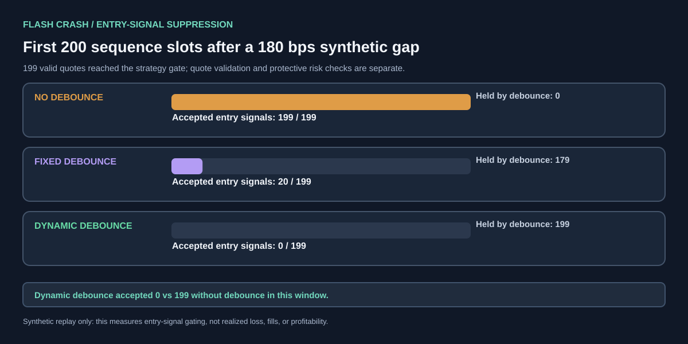

# Sentinel StatArb — HPC validation report

**Original baseline:** [Sentinel StatArb HPC CPU Validation #8](https://github.com/SpryzenHell/integrator/actions/runs/38569070387) — success.  
**Latest follow-up:** [Sentinel StatArb HPC CPU Validation #9](https://github.com/SpryzenHell/integrator/actions/runs/38571496094) — success; latest metrics and crash-window checks are appended below.  
**Latest Sentinel StatArb source commit tested:** `bd7f72c365fb9d40d2e90ac778cfde1005b68ff8`.  
**Machine-readable reports:** [`integrator/main/artifacts/sentinel-statarb-hpc/`](https://github.com/SpryzenHell/integrator/tree/main/artifacts/sentinel-statarb-hpc)

## Host and test conditions

- Host: `scn11-mn.mgmt.siddhi.param`; Ubuntu 22.04.4; Linux 5.15.
- CPU: dual AMD EPYC 7742 64-Core processors; 128 physical cores / 256 logical CPUs reported by `lscpu`.
- GPU present: 2× NVIDIA A100-SXM4-40GB; Driver 550.90.07 / CUDA 12.4. The measured project workload was CPU-only and did not launch CUDA kernels.
- Toolchain: GCC 11.4.0, CMake 3.22.1, CPython 3.12.15.
- Validation: 24 Python unit/integration tests passed; 4/4 CTest native tests passed; generated reports and SVG checks passed.

## 1. Native C++ engine and CPython/GIL comparison

### 10M-tick native run

| Metric | HPC result |
|---|---:|
| Synthetic ticks | 10,000,000 |
| Warm-up ticks excluded from throughput | 10,000 |
| Measured ticks | 9,990,000 |
| Throughput | 37,767,022 events/s |
| Sampled processing p50 | 0.050 μs |
| Sampled processing p95 | 0.051 μs |
| Sampled processing p99 | 0.051 μs |
| Invalid ticks | 0 |
| Queue atomics lock-free on host | true |

Sampled processing latency surrounds only the native order/debouncer hot path. It is not end-to-end market-to-order latency. Throughput is the full measured producer/consumer simulation rate and is not interchangeable with the sampled hot-path timing.

### Paired native-vs-Python threaded pipeline

The benchmark ran the same seeded one-million-tick price path, timestamp progression, queue capacity, debounce rules, and stop-limit settings in native C++ and in a CPython producer/consumer pipeline. One warm-up invocation per implementation was excluded; five measured runs were recorded. This CPython build reported the GIL enabled.

| Metric | Native C++ | CPython threaded |
|---|---:|---:|
| Median throughput | 48,794,396 events/s | 264,621 events/s |
| Sampled processing p50 | 0.040 μs | 1.333 μs |
| Sampled processing p95 | 0.051 μs | 1.483 μs |
| Sampled processing p99 | 0.051 μs | 1.593 μs |

**Measured throughput ratio: 184.39× in favor of native C++.** Semantic parity passed for all checked fields: tick/warm-up counts, accepted and debounced signal counts, one stop trigger, stop-limit marketability after the crash gap, zero invalid ticks, and queue capacity. Raw throughput repeats are included in the JSON report.

This measures a complete C++ SPSC-vs-CPython `queue.Queue` producer/consumer pipeline, so the ratio includes queue implementation, Python object/interpreter overhead, and the GIL; it must not be described as an isolated measurement of GIL overhead alone. It establishes a machine- and workload-specific HPC comparison, not a universal speedup.

## 2. Dynamic debouncer and 5 bps OCO stop-limit

The 100K seeded synthetic replay injects duplicate sequence numbers, older timestamps, stale quotes, and a 180 bps price gap. The gap is intentionally larger than the stop-limit offset.

| Policy | Accepted signals | Held-back signals | Stop triggers | Stop-limit marketable after gap? |
|---|---:|---:|---:|---|
| No debounce | 99,427 | 0 | 1 | No |
| Fixed debounce | 9,953 | 89,474 | 1 | No |
| Dynamic debounce | 9,934 | 89,493 | 1 | No |

Dynamic debounce accepted **90.01% fewer signals** than the no-debounce policy in this experiment. Each policy's protective-order check still triggered once; after the 180 bps gap, the 5 bps-offset stop-limit was not marketable. Unit tests also verify the exact 5 bps price calculation, one-shot OCO behavior, invalid settings, and order checks even when the signal itself is debounced.

These are synthetic signal-control and order-price tests, not realized P&L, live fills, or proof of a specific reduction in real-market loss. A stop-limit order can trigger yet remain unfilled after a gap.

## 3. Quote integrity, IPC and async DuckDB persistence

### Quote validation

The HPC replay counted 1,030 duplicate-sequence events, 473 older-timestamp events, and 100 stale events; they were rejected before signals were created. Separate tests exercise excessively future-dated quote rejection. The current seeded stress stream has no future-dated samples, so its future count is zero.

### Lock-free shared-memory IPC

The shared-memory SPSC ring uses process-shared `MAP_SHARED` memory and atomics checked with `is_lock_free()`. The queue-capacity sweep used 200,000 measured messages after 20,000 warm-up messages per capacity.

| Capacity | p50 one-way | p95 one-way | p99 one-way | Throughput |
|---:|---:|---:|---:|---:|
| 16 | 3.397 μs | 3.887 μs | 6.102 μs | 2.48M messages/s |
| 64 | 7.434 μs | 10.500 μs | 12.172 μs | 4.75M messages/s |
| 256 | 24.386 μs | 28.254 μs | 30.127 μs | 6.46M messages/s |
| 1,024 | 90.661 μs | 107.935 μs | 112.243 μs | 7.11M messages/s |

**The lowest-latency tested setting was capacity 16: p50 3.397 μs and p99 6.102 μs**, with zero sequence/timestamp errors and lock-free atomics. Its maximum observed latency was 1,428.499 μs, so the result is a percentile claim—not a guarantee that every handoff stays below 10 μs. Capacity 64 showed p99 12.263 μs in the standalone run, demonstrating scheduler/backlog sensitivity.

### ZeroMQ is separate from lock-free IPC

| Native ZeroMQ path | p50 | p95 | p99 |
|---|---:|---:|---:|
| One-way IPC | 25.999 μs | 27.863 μs | 31.009 μs |
| Request/reply round trip | 51.398 μs | 56.848 μs | 61.456 μs |

Payload and sequence checks passed, but **ZeroMQ is not lock-free and did not meet the sub-10 μs target**. The low-latency lock-free result comes from the separate shared-memory SPSC transport. Do not describe it as “lock-free ZeroMQ IPC.”

### DuckDB stress test

| Metric | HPC result |
|---|---:|
| Warm-up rows | 10,100,000 |
| Measured rows requested | 10,100,000 |
| Rows written | 10,100,000 |
| Rows read back | 10,100,000 |
| Distinct sequence IDs | 10,100,000 |
| Sequence range | 0–10,099,999 |
| Invalid bid/ask rows | 0 |
| Measured elapsed time | 41.789 s |
| Throughput | 241,690 rows/s |
| Database size | 136,065,024 bytes |

The async writer completed both the warm-up and measured pass; every requested row was present on read-back, all sequences were unique, and all bid/ask values passed validation.

## Measurement scope and interpretation

- The paired native/Python throughput ratio measures two complete synthetic pipelines; queue implementation, interpreter work, threading, compilation, and host scheduling all contribute.
- Debounce counts measure simulated entry-signal gating. They do not establish realized loss, live-market profitability, exposure reduction, or fills.
- The capacity-16 low-latency IPC figures are from the process-shared SPSC ring with lock-free atomics on this host. ZeroMQ is a separate transport and is not lock-free.
- The DuckDB stress test checks persistence integrity by verifying row count, unique sequence identifiers, value validity, and complete read-back.

## Artifacts and reproducibility

- [HPC workflow run #8 (success)](https://github.com/SpryzenHell/integrator/actions/runs/38569070387)
- [Persisted HPC JSON/CSV reports and machine information on `integrator/main`](https://github.com/SpryzenHell/integrator/tree/main/artifacts/sentinel-statarb-hpc)
- [Paired benchmark source](https://github.com/SpryzenHell/sentinel_statarb/blob/main/scripts/benchmark_gil_pipeline.py)
- [Report validator](https://github.com/SpryzenHell/sentinel_statarb/blob/main/scripts/validate_reports.py)

All inputs in the benchmark remain synthetic. The run validates code paths and measurements on the HPC machine; it is not a live trading deployment or a claim of market profitability.

## Latest follow-up: HPC run #9 (October 14, 2026)

Run #9 reran the updated source with the measured 200-slot post-crash entry-signal window. Workflow outcome was success and `run-status.txt` on `integrator/main` records `workflow_outcome=success` with tested source commit `bd7f72c365fb9d40d2e90ac778cfde1005b68ff8`.

### Native simulation and paired pipeline

| Metric | HPC #9 result |
|---|---:|
| Native 1M-tick rate | 42,623,221 events/s; sampled p50/p95/p99 = 0.050/0.051/0.051 μs |
| Native 10M-tick rate | 38,677,888 events/s; sampled p50/p95/p99 = 0.040/0.051/0.051 μs |
| Native 10M invalid ticks | 0 |
| Paired 1M-tick median rate | Native 44,568,909 events/s; CPython threaded 264,571 events/s |
| Paired native/Python throughput ratio | 168.46× |
| Paired sampled processing p50/p95/p99 | Native 0.049/0.051/0.051 μs; Python 1.362/1.483/1.583 μs |
| Paired semantic parity | Pass: all counters, stop outcome and invalid-tick checks match |

Raw paired C++ throughput repeats (events/s): 35,549,769.28; 44,568,909.25; 39,777,889.91; 51,828,816.43; 48,515,767.89. Raw CPython repeats: 264,571.456; 261,131.542; 278,869.628; 274,915.399; 261,877.269. One full invocation per implementation was discarded as warm-up, and each median was calculated from five measured runs.

### Signal policy and local crash-window result

| Policy | Accepted full-stream | Held full-stream | Reduction vs no debounce | First-window valid quotes | Accepted entries in first 200 slots | Held in first 200 slots |
|---|---:|---:|---:|---:|---:|---:|
| No debounce | 99,427 | 0 | 0.00% | 199 | 199 | 0 |
| Fixed debounce | 9,953 | 89,474 | 89.99% | 199 | 20 | 179 |
| Dynamic debounce | 9,934 | 89,493 | 90.01% | 199 | 0 | 199 |

Input details: seed `20261011`; 100,000 base ticks plus 1,030 duplicate-sequence inputs; 101,030 total events; 10,000 ns timestamp progression; crash/gap at sequence 55,000 (55% through base stream); 180 bps price drop; one warm-up and three measured repeats per policy. All policies saw 1,030 duplicate sequence events, 473 out-of-order timestamp events, 100 stale quotes, and zero future-dated events in this specific stream. Each policy triggered one protective stop; after the gap, the 5 bps-offset stop-limit was not marketable.

### IPC follow-up

| Transport/configuration | p50 | p95 | p99 | More detail |
|---|---:|---:|---:|---|
| Shared-memory SPSC capacity 16 | 3.546 μs | 4.158 μs | 6.452 μs | Max 87.586 μs; 2.410M msg/s; lock-free atomics; zero sequence/time errors |
| Shared-memory SPSC capacity 64 standalone | 7.173 μs | 10.089 μs | 11.943 μs | Max 52.089 μs; 5.017M msg/s; zero errors |
| Native ZeroMQ one-way | 26.249 μs | 28.153 μs | 33.012 μs | 20K messages; 0 bad payloads; not lock-free |
| Native ZeroMQ ACK RTT | 51.878 μs | — | 63.601 μs | Mean 56.280 μs; serial paced measurement |
| Native ZeroMQ request/reply RTT | 52.229 μs | 56.537 μs | 62.098 μs | 18,395 RTT/s |
| Python ZeroMQ process RTT | 61.516 μs | 66.587 μs | 73.099 μs | Payload check passed |

Full shared-memory capacity sweep (20,000 warm-ups plus 200,000 measured messages each):

| Capacity | p50 | p95 | p99 | Max | Throughput |
|---:|---:|---:|---:|---:|---:|
| 16 | 3.546 μs | 4.158 μs | 6.452 μs | 87.586 μs | 2,409,717 msg/s |
| 64 | 7.384 μs | 9.929 μs | 11.692 μs | 40.487 μs | 4,929,058 msg/s |
| 256 | 24.076 μs | 27.922 μs | 29.877 μs | 123.985 μs | 6,660,278 msg/s |
| 1,024 | 87.225 μs | 103.837 μs | 111.461 μs | 256.076 μs | 7,346,939 msg/s |

Capacity 16 gave the lowest p50/p99 among tested ring sizes. Its observed maximum exceeds 10 μs, so the claim is percentile-based, not a guaranteed per-message latency ceiling. ZeroMQ is a separate non-lock-free transport and did not meet the sub-10 μs target.

### Async DuckDB storage follow-up

| Metric | HPC #9 measured pass |
|---|---:|
| Separate warm-up rows | 10,100,000 |
| Measured rows requested / written / read back | 10,100,000 / 10,100,000 / 10,100,000 |
| Distinct sequence IDs | 10,100,000 |
| Sequence range | 0–10,099,999 |
| Bad bid/ask rows | 0 |
| Elapsed | 41,786.738 ms |
| Throughput | 241,703.477 rows/s |
| Database size | 136,065,024 bytes |

Both the warm-up and measured DBs passed full read-back and validity checks. This is synthetic generated data and host-specific write/read throughput.

### Execution/test results and boundary

- Python unit/integration suite: 24/24 passed.
- CTest native suite: 4/4 passed.
- JSON/CSV/SVG report validation: all passed.
- The A100 GPUs were recorded for host provenance but were not used for GPU computation.
- All market-event data is synthetic; these experiments do not run against a broker and do not establish live profitability, realized slippage, or guaranteed stop-limit fills.
